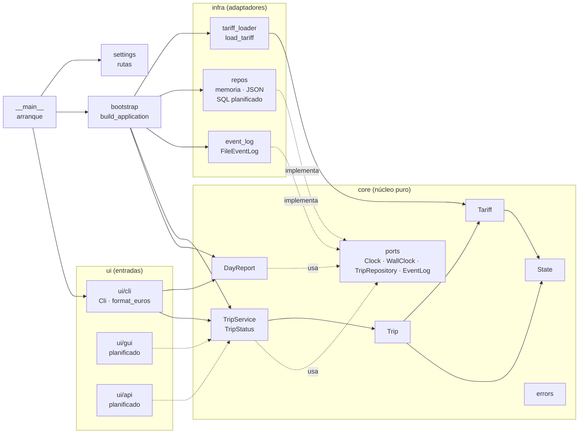
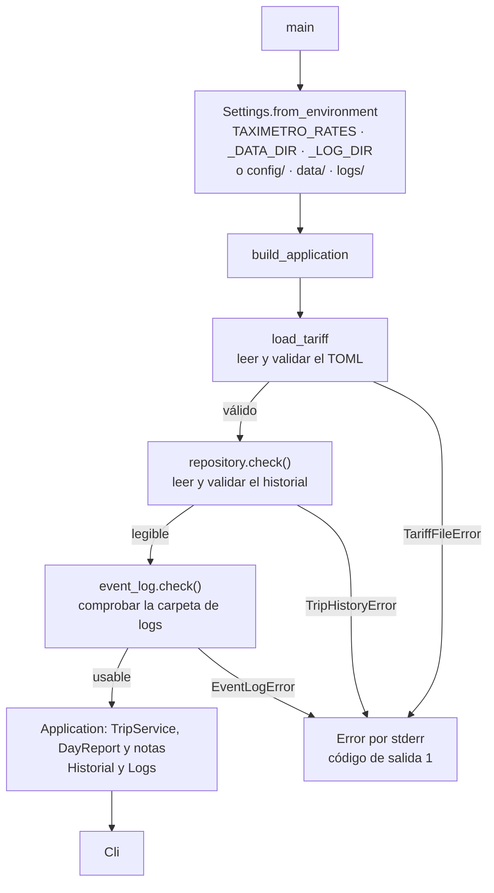

<!--
Proyecto: py-taximetro
fuente: docs/ARCHITECTURE.md
-->

# Arquitectura del taxímetro digital (TTX-247)

| | |
|---|---|
| **Proyecto** | py-taximetro (prototipo de TaxiTech Solutions S.L.) |
| **Alcance que refleja** | Fase 1 (MVP CLI): US-01 a US-04 y TK-02, más de la Fase 2: US-07 (tarifas en fichero de configuración), TK-04 (historial de carreras en disco), US-05 (histórico del día) y US-06 (logs de operación) y TK-03 (umbral de cobertura del núcleo) |
| **Fuente de verdad** | El código en `src/taximetro/`. Si algo de este documento y el código difieren, manda el código. |

> **Convención de estado.** Cada elemento lleva una marca: ✅ implementado y probado, 🟡 existe pero aún no se usa, ⏳ planificado (no existe todavía).

---

## 1. Propósito y alcance

TaxiTech Solutions necesita sustituir sus taxímetros físicos por una solución 100 % software. Este repositorio es el **prototipo** que valida el concepto antes de contratar a un proveedor.

El taxímetro funciona por línea de comandos (Fase 1, más US-07 y TK-04 de la Fase 2) y:

- cobra por segundo según el estado del taxi (parado o en movimiento),
- muestra el importe acumulado y el total final en euros,
- permite encadenar carreras sin cerrar el programa,
- lee sus tarifas de un fichero de configuración, de modo que cambiar el cobro no exige tocar el código (US-07),
- guarda cada carrera finalizada en un historial en disco que se conserva al cerrar el programa, sin que un fallo del historial esconda nunca el importe (TK-04),
- permite consultar las carreras de hoy o de otro día, con su hora, su importe y el total (US-05),
- registra el inicio, los cambios de estado y el fin de cada carrera en un log de operación para auditar el uso, sin que un fallo del log impida cobrar (US-06).

Este documento describe **cómo está construido** (módulos) y **qué hace** (arquitectura funcional). El diseño de las clases está en [DESIGN.md](DESIGN.md) y el **porqué** de cada decisión, en [DECISIONS.md](DECISIONS.md). Las fases 2 a 4 se recogen como evolución prevista en la sección 9.

---

## 2. Visión general

### 2.1 Estilo arquitectónico

**Núcleo puro con puertos y adaptadores (versión ligera).** El cálculo del negocio vive en un núcleo sin entrada/salida ni librerías externas. Todo lo que toca el mundo exterior (teclado, pantalla, reloj, disco) se queda en los bordes y se conecta al núcleo mediante contratos pequeños.

Tres paquetes y tres módulos de raíz que los conectan:

| Paquete | Rol | Estado |
|---|---|---|
| `core/` | Reglas de negocio y casos de uso. No importa nada de `ui/` ni de `infra/`. | ✅ |
| `ui/` | Puertas de entrada del usuario: CLI hoy; GUI y API después. | ✅ CLI · ⏳ GUI, API |
| `infra/` | Adaptadores a recursos externos (carga de configuración, repositorios de datos, logging). | ✅ carga de tarifas, repositorios (memoria y JSON) y registro de eventos · ⏳ repositorio SQL |
| `settings.py` | Ajustes: de dónde salen las tarifas, los datos y los logs. | ✅ |
| `bootstrap.py` | Monta la aplicación: crea las piezas reales a partir de los ajustes y las conecta. | ✅ |
| `__main__.py` | Punto de arranque: pide la aplicación a `bootstrap` y lanza la consola. | ✅ |

**Regla de dependencias (solo hacia dentro):**

```
__main__ · bootstrap · settings   (la raíz: conectan todo)
      →  ui     →  core
      →  infra  →  core
```

El núcleo no conoce a nadie. Esa regla es la que permite probarlo sin teclado, sin pantalla y sin esperar tiempo real. No es solo una convención: `tests/test_architecture.py` lee los imports de cada fichero y falla si `core/` importa de otra capa o si `ui/` e `infra/` importan algo que no sea `core/` (decisión [D25](DECISIONS.md#d25)).

### 2.2 Diagrama de componentes



Los bloques marcados como `planificado` (GUI, API y el repositorio SQL) aún no existen en el código. Las líneas discontinuas indican «usa» o «implementa» un contrato.

---

## 3. Módulos codificados

### 3.1 Núcleo — `src/taximetro/core/`

| Módulo | Responsabilidad | Depende de | Estado |
|---|---|---|---|
| `state.py` | Enumeración `State` con los estados del taxi: `STOPPED` y `MOVING`. Vive en su propio módulo para evitar una importación circular entre `Tariff` y `Trip`. | — | ✅ |
| `errors.py` | Jerarquía de errores del dominio, con `TaximetroError` como base. Incluye `TariffFileError` (fallos al cargar las tarifas) y, para el historial: `InvalidTripRecord` (carrera que no se puede guardar: sin terminar o sin fechas), `TripHistoryError` (fichero dañado o ilegible) `TripNotSaved` (la carrera se cobró pero no se guardó; lleva el total) y `EventLogError` (la carpeta del registro de eventos no se puede usar). | — | ✅ |
| `tariff.py` | `Tariff`: precio por segundo parado y en movimiento. Es inmutable (`frozen`), rechaza valores negativos y expone `rate_for(state)`. Los valores reales los aporta el cargador de tarifas (`infra/`). | `state`, `errors` | ✅ |
| `trip.py` | `Trip`: una carrera. Acumula el importe por tramos, cierra un tramo en cada cambio de estado y redondea el total a céntimos. **No conoce ningún reloj**: recibe el instante (`at`) en cada operación y, opcionalmente, la fecha y hora de pared (`when`). Acumula también los segundos parado y en movimiento, y expone `started_at` y `finished_at`. `Trip.restore(...)` reconstruye una carrera ya terminada a partir de los datos guardados. | `state`, `tariff`, `errors` | ✅ |
| `trip_service.py` | `TripService`: caso de uso que **opera** el taxímetro. Mantiene la carrera activa, lee los dos relojes y delega el cálculo en `Trip`. `status()` entrega el estado de la carrera en curso ya calculado (`TripStatus`: estado e importe), de modo que la interfaz no lee la entidad `Trip`. Al finalizar guarda la carrera en el repositorio y libera la carrera activa para encadenar la siguiente, **incluso si el guardado falla** (en ese caso lanza `TripNotSaved` con el total). Anota en el registro de eventos el inicio, los cambios de estado, el fin y las carreras no guardadas; si el registro falla, lo ignora (`_log`). | `trip`, `tariff`, `ports`, `errors` | ✅ |
| `day_report.py` | `DayReport`: caso de uso de **consulta**. `for_day(día)` devuelve un `DaySummary` (día, carreras, número y total) con las carreras terminadas ese día; sin día, las de hoy según el reloj de pared. Solo lee del repositorio: no opera el taxímetro (decisión [D26](DECISIONS.md#d26)). | `trip`, `ports` | ✅ |
| `ports.py` | Contratos (`Protocol`): `Clock` (segundos monotónicos, para medir duraciones), `WallClock` (fecha y hora con zona horaria, para saber *cuándo*), `TripRepository` (`save`, `list_finished` y `check`) y `EventLog` (`record`: anota un evento con su hora). | `trip` | ✅ |

La API pública de `Trip`, `TripService` y `DayReport`, y el diseño de cada clase, están en [DESIGN.md](DESIGN.md#3-diseño-clase-a-clase).

### 3.2 Interfaz de línea de comandos — `src/taximetro/ui/cli/`

| Módulo | Responsabilidad | Estado |
|---|---|---|
| `app.py` | `Cli`: bucle de lectura de comandos. Traduce cada comando a una llamada a `TripService` (operar y consultar el estado en curso) o a `DayReport` (el histórico del día) y los errores de dominio a mensajes legibles. Recibe el servicio, el informe del día, `input_fn`, `output_fn` y las notas, por lo que se puede probar sin teclado ni pantalla. Contiene el texto de ayuda (`HELP`) y la tabla de mensajes de error (`ERRORS`). Al arrancar imprime las **notas** que recibe (por ejemplo, la ruta del historial) entre el título y la ayuda, sin saber de dónde vienen; y si el guardado falla al finalizar, muestra el total seguido de un `Aviso:`. | ✅ |
| `format.py` | `format_euros`: función pura que formatea un importe como `0,70 €` (coma decimal, dos decimales, redondeo medio hacia arriba). | ✅ |

**Comandos disponibles:**

| Comando | Acción |
|---|---|
| `iniciar` | Inicia una carrera (el taxi empieza parado). |
| `parar` | Pasa al estado parado. |
| `mover` | Pasa al estado en movimiento. |
| `estado` | Muestra el estado y el importe actual. |
| `finalizar` | Termina la carrera y muestra el total. |
| `historico [AAAA-MM-DD]` | Lista las carreras finalizadas de hoy o del día indicado, con su hora, su importe y el total. |
| `ayuda` | Repite las instrucciones. |
| `salir` | Cierra el programa (avisa si hay una carrera sin cobrar). |

La entrada no distingue mayúsculas ni espacios sobrantes, e ignora las líneas vacías. `historico` es el único comando con argumento: `Cli._dispatch` separa la línea en nombre y argumento solo para él, y los demás siguen buscándose por línea completa (`iniciar hola` es un comando desconocido). Una fecha que no es `AAAA-MM-DD` muestra `Fecha no válida…` y el programa sigue.

### 3.3 Infraestructura — `src/taximetro/infra/`

| Módulo | Responsabilidad | Estado |
|---|---|---|
| `tariff_loader.py` | `load_tariff(path)`: lee un fichero TOML y devuelve un `Tariff`. Convierte **todos** los fallos posibles en un único `TariffFileError`, con la clave o el fichero implicado, y conserva el error original como causa. | ✅ |
| `repos/memory.py` | `InMemoryTripRepository`: guarda las carreras en una lista; se pierden al cerrar el programa. Lo usan las pruebas. Su `check()` no hace nada: en memoria no hay nada que pueda estar dañado. | ✅ |
| `repos/json_file.py` | `JsonTripRepository(path)`: guarda las carreras terminadas en un fichero JSON. Escritura atómica, errores claros, creación de carpetas y comprobación al arrancar con `check()` (ver abajo). | ✅ |
| `repos/validation.py` | `ensure_can_be_saved`: reglas comunes a todo repositorio (la carrera debe estar terminada y tener fechas). | ✅ |
| `folders.py` | `file_in_the_way(carpeta)`: devuelve el fichero que impide usar una ruta como carpeta (la propia ruta o la primera que exista por encima), o `None`. La comparten el repositorio JSON y el registro de eventos; cada uno pone su propio mensaje. | ✅ |
| `repos/` (SQL) | Repositorio relacional (Fase 4). | ⏳ |
| `event_log.py` | `FileEventLog(carpeta)`: escribe cada evento como una línea JSON en el fichero del día. `check()` crea la carpeta, prueba que se puede escribir y convierte los fallos en `EventLogError` (ver abajo). | ✅ |

El cargador se organiza en una función pública y cuatro privadas, cada una con una sola responsabilidad:

| Función | Responsabilidad |
|---|---|
| `load_tariff` | Orquesta: leer, localizar la tabla, extraer las claves y convertir |
| `_read_toml` | Abrir y decodificar el fichero (ausente, ilegible, codificación, sintaxis) |
| `_rates_table` | Localizar la tabla `[rates]` y comprobar que lo es |
| `_required_values` | Extraer las claves `stopped` y `moving` |
| `_to_decimal` | Validar y convertir un valor: texto, número, finito y no negativo |

El formato del fichero y los mensajes de error están en el [manual de uso](USAGE.md#7-configurar-las-tarifas).

#### Repositorio JSON

El fichero es una lista de registros, uno por carrera terminada:

```json
[
  {
    "id": "…",
    "started_at": "2026-11-11T10:00:00+01:00",
    "finished_at": "2026-11-11T10:05:00+01:00",
    "stopped_seconds": "30",
    "moving_seconds": "20",
    "total": "1.00"
  }
]
```

Las fechas se guardan en ISO 8601 con zona horaria y los importes y segundos **como texto**, para que `Decimal` no pase por `float` y no pierda precisión.

| Comportamiento | Cómo |
|---|---|
| **Escritura atómica** | `save` escribe en un fichero temporal en la misma carpeta y lo intercambia con `os.replace`. Un corte a mitad de escritura deja el historial anterior intacto; si algo falla, se borra el temporal |
| **Historial dañado** | Un fichero vacío, que no es JSON, que no es una lista o con un registro ilegible lanza `TripHistoryError` con la ruta y un motivo legible: la línea y la columna donde falla el JSON, que no está en UTF-8 o el número de la carrera ilegible, sin textos técnicos del intérprete. `save` valida **antes** de escribir, así que un fichero dañado nunca se sobrescribe |
| **Historial ilegible** | Un fichero que existe pero no se puede leer (permisos, es una carpeta) también lanza `TripHistoryError` |
| **Carpeta de datos inválida** | Si la carpeta de datos, o la primera que exista por encima, es un fichero, lanza `TripHistoryError` nombrándola. Un primer arranque, con las carpetas aún sin crear, sigue siendo válido |
| **Primer arranque** | Si el fichero no existe, el historial está vacío. Listar nunca crea nada; guardar crea las carpetas que falten |
| **Comprobación al arrancar** | `check()` lee y valida todas las carreras con la misma lectura que `list_finished`, sin pedir un día, y lanza `TripHistoryError` si algo está mal. Un fichero inexistente es válido y no se crea nada. Así un historial dañado se avisa al arrancar y no al cobrar |
| **Qué carreras lista** | `list_finished(día)` devuelve las que **terminan** ese día, de la más antigua a la más reciente por hora de fin |

El repositorio en memoria y el JSON pasan la misma batería de tests de contrato (`tests/contract/`).
#### Registro de eventos

`TripService` anota los eventos de operación en un `EventLog`. La implementación real, `FileEventLog`, escribe **JSON Lines**: una línea por evento, en un fichero por día (`taximetro-AAAA-MM-DD.jsonl`) dentro de la carpeta de logs.

```json
{"ts": "2026-11-16T10:05:00.123456+01:00", "evento": "carrera_iniciada", "carrera": "a1b2c3d4"}
```

| Evento | Quién lo registra | Datos |
|---|---|---|
| `carrera_iniciada` | `TripService.start` | `carrera` |
| `estado_cambiado` | `TripService.set_state` | `carrera`, `estado` (valor interno: `stopped` o `moving`) |
| `carrera_finalizada` | `TripService.finish`, antes de guardar | `carrera`, `total` (texto) |
| `carrera_no_guardada` | `TripService.finish`, si falla el historial | `carrera`, `motivo` |

| Comportamiento | Cómo |
|---|---|
| **Hora determinista** | La marca de tiempo es la del reloj de pared inyectado, no la del sistema. `start` y `finish` leen el reloj **una sola vez**, así que el log y el historial coinciden |
| **Un fichero por día** | El nombre sale de la fecha del evento, y cada evento se añade abriendo el fichero en modo *append*: una caída no deja eventos sin volcar y nada se pisa |
| **Acentos legibles** | `ensure_ascii=False`: la `ñ` y las tildes se escriben tal cual |
| **Comprobación al arrancar** | `check()` crea la carpeta, prueba a escribir con un fichero temporal dentro de ella y lanza `EventLogError` con la ruta y el motivo. Como el log sirve para auditar, `main` **aborta** (código 1) si falla |
| **Fallo durante la jornada** | `TripService._log` ignora los `OSError` del registro: cobrar es lo primero, y el taxista nunca ve un error por culpa del log |

### 3.4 Ajustes y arranque — `settings.py`, `bootstrap.py` y `__main__.py` ✅

Los tres módulos de la raíz son los únicos que conocen todas las capas (*composition root*). Se ejecuta con `python -m taximetro` o con el comando `taximetro` (definido en `pyproject.toml`).

| Módulo | Función |
|---|---|
| `settings.py` | `Settings(rates_path, data_dir, log_dir)`: de dónde salen las tarifas, los datos y los logs. `Settings.from_environment(environ, rates_path=…, data_dir=…, log_dir=…)` usa el valor explícito si lo hay; si no, la variable de entorno (`TAXIMETRO_RATES`, `TAXIMETRO_DATA_DIR`, `TAXIMETRO_LOG_DIR`; una variable vacía se ignora); y si no, el valor por defecto en la raíz del proyecto (`config/rates.toml`, `data/`, `logs/`). `trips_file` es `trips.json` dentro de la carpeta de datos. |
| `bootstrap.py` | `build_application(settings, clock, wall_clock)` crea el repositorio JSON y el registro de eventos con esas rutas, carga las tarifas, monta `TripService` y `DayReport`, **comprueba** el historial (`check()`) y la carpeta de logs, y devuelve una `Application` con el servicio, el informe y las notas `Historial: <ruta>` y `Logs: <ruta>`. Lanza `TariffFileError`, `TripHistoryError` o `EventLogError` si algo impide arrancar. Contiene también `local_now()`, el reloj de pared real. |
| `__main__.py` | `main(rates_path, data_dir, clock, input_fn, output_fn)`: construye los ajustes, pide la aplicación a `bootstrap`, convierte los tres errores de arranque en `Error: …` por `stderr` con código de salida `1` y lanza la CLI. Devuelve `0` si todo va bien. Es un cableado fino: la `Application` es lo mismo que pedirían una GUI o una API. |

Reloj, entrada y salida se inyectan, por lo que el arranque completo se prueba sin teclado ni esperas. Además, el arranque real se prueba lanzando `python -m taximetro` en un proceso aparte (decisión [D29](DECISIONS.md#d29)).

#### Ubicaciones de datos

| Qué | Variable | Por defecto | Estado |
|---|---|---|---|
| Tarifas (un fichero, solo lectura) | `TAXIMETRO_RATES` | `config/rates.toml` | ✅ |
| Historial (`trips.json`) | `TAXIMETRO_DATA_DIR` | `data/` | ✅ |
| Logs de operación | `TAXIMETRO_LOG_DIR` | `logs/` | ✅ |

Los datos y los logs son **dos carpetas independientes** para poder montarlas en ubicaciones distintas en producción. Se configuran como carpetas y no como ficheros porque la escritura atómica necesita crear un temporal junto al fichero final, y montar un único fichero lo impediría (decisión [D18](DECISIONS.md#d18)).

### 3.5 Elementos que existen pero aún no se usan

| Elemento | Situación |
|---|---|
| `ui/gui/`, `ui/api/` | Paquetes vacíos que reservan el sitio de las fases 3 y 4. |

---

## 4. Arquitectura funcional

### 4.1 Modelo de cálculo

El importe de una carrera y las reglas de negocio que lo gobiernan se explican en [DESIGN.md](DESIGN.md#modelo-de-calculo), junto con el análisis del dominio.

### 4.2 Trazabilidad: historia de usuario → módulos → pruebas

| Historia | Qué cubre | Módulos que intervienen | Prueba de aceptación |
|---|---|---|---|
| **US-01** (#2) | Iniciar una carrera con un comando | `Cli._start`, `TripService.start`, `Trip.start` | `test_us01_iniciar_carrera_con_un_comando` |
| **US-02** (#3) | Cambiar entre parado y en movimiento | `Cli._set_state`, `TripService.set_state`, `Trip.change_state`, `Tariff.rate_for` | `test_us02_cambiar_entre_parado_y_en_movimiento` |
| **US-03** (#4) | Finalizar y ver el total en euros | `Cli._finish`, `TripService.finish`, `Trip.finish`, `format_euros` | `test_us03_finalizar_muestra_el_total_con_dos_decimales` |
| **US-04** (#5) | Encadenar carreras sin cerrar el programa | `TripService.finish` (libera la carrera activa), bucle de `Cli.run` | `test_us04_encadenar_carreras_sin_cerrar_el_programa` |
| **TK-02** (#12) | Instrucciones de uso al arrancar | `HELP` y `Cli.run` | `test_muestra_instrucciones_al_arrancar` |
| **US-07** (#8) | Tarifas en fichero de configuración | `load_tariff`, `Settings.rates_path`, `build_application`, `main` | `test_la_aplicacion_cobra_con_las_tarifas_del_fichero_de_los_ajustes` y `test_con_un_fichero_valido_lanza_la_cli_con_esas_tarifas_y_devuelve_0` |
| **TK-04** (#14) | Historial guardado en disco | `JsonTripRepository`, `ensure_can_be_saved`, `TripService.finish`, `Trip.restore`, `Settings.data_dir`, `build_application` | `test_las_carreras_terminadas_se_conservan_al_reiniciar_el_programa` y el resto de `test_fase2_historial.py` |
| **US-05** (#6) | Ver el histórico del día (o de otro día) | `Cli._history`, `Cli._dispatch`, `DayReport.for_day` y `today`, `TripRepository.list_finished` | `test_us05_el_historico_del_dia_conserva_las_carreras_al_reiniciar` y el resto de `test_us05_historico.py` |
| **US-06** (#7) | Logs de operación | `EventLog`, `FileEventLog`, `TripService._log`, `Settings.log_dir`, `build_application` | `test_us06_una_carrera_deja_inicio_cambio_de_estado_y_fin_con_marca_de_tiempo` y el resto de `test_us06_logs.py` |
| **TK-03** (#13) | Tests automatizados de la lógica de cálculo (cobertura ≥ 90 % en `core/`) | `[tool.coverage]` de `pyproject.toml` | `tests/test_quality_gates.py` y `python -m pytest --cov` |
| **TK-05** (#15) | Refactor a POO con responsabilidades separadas | `Settings`, `DayReport`, `TripStatus`, `TripRepository.check`, `build_application`, `main` | `tests/test_architecture.py`, `tests/integration/test_bootstrap.py` y `tests/acceptance/test_arranque_real.py` |
| **TK-12** (#32) | Script de verificación de pruebas y cobertura | `scripts/verificar.py` | `tests/unit/test_verificar.py` |
| — | Consulta del importe en curso (`estado`) | `Cli._status`, `TripService.status`, `Trip.amount_at` | `test_estado_con_carrera_muestra_estado_e_importe` |

### 4.3 Ciclo de vida de una carrera

El ciclo de vida de una carrera (sin iniciar, parado, en movimiento y finalizada) está en [DESIGN.md](DESIGN.md#ciclo-de-vida).

### 4.4 Flujo de una carrera completa

Cómo colaboran los objetos durante una carrera completa se explica, con su diagrama de secuencia, en [DESIGN.md](DESIGN.md#flujo-de-una-carrera).

### 4.5 Arranque: tarifas, historial y logs



Si el fichero de tarifas, el historial o la carpeta de logs son inválidos el programa **no arranca**: no existe ninguna tarifa por defecto (decisión [D11](DECISIONS.md#d11)), un historial dañado no se sobrescribe (decisión [D17](DECISIONS.md#d17)) y sin logs no hay auditoría (decisión [D22](DECISIONS.md#d22)).

### 4.6 Manejo de errores

Los errores de negocio son excepciones del dominio. `Cli._dispatch` las captura y muestra un mensaje; el programa **no se cierra**.

| Excepción | Cuándo se lanza | Mensaje en la CLI |
|---|---|---|
| `TripNotStarted` | Cambiar estado, consultar o finalizar sin carrera activa | "No hay ninguna carrera en curso. Usa 'iniciar'." |
| `TripAlreadyStarted` | Iniciar con otra carrera ya en curso | "Ya hay una carrera en curso. Usa 'finalizar' antes de iniciar otra." |
| `TripAlreadyFinished` | Operar sobre una `Trip` ya finalizada | "La carrera ya está finalizada." |
| `InvalidTimestamp` | Instante anterior al último registrado | "El reloj retrocedió; no se puede continuar la carrera." |
| `InvalidTariff` | Construir una `Tariff` con valores negativos | No llega a la CLI: el cargador valida antes los valores del fichero |
| `TariffFileError` | El fichero de tarifas falta, no se puede leer, está mal formado o tiene valores inválidos | No llega a la CLI: al arrancar se imprime `Error: …` por `stderr` y el código de salida es 1 |
| `TripHistoryError` | El historial está dañado (no es JSON, no es una lista, un registro ilegible), existe pero no se puede leer, o la carpeta de datos es en realidad un fichero | **Al arrancar**: `Error: …` por `stderr` y código de salida 1. **Al finalizar una carrera**: `TripService` lo convierte en `TripNotSaved` |
| `TripNotSaved` | La carrera se cobró, pero no se pudo guardar (`OSError` o `TripHistoryError`) | La CLI muestra `Carrera finalizada. Total: …` y después `Aviso: No se pudo guardar la carrera en el historial: …` |
| `EventLogError` | La carpeta de logs no se puede crear o no se puede escribir en ella | **Al arrancar**: `Error: …` por `stderr` y código de salida 1. **Durante la jornada**, un fallo de escritura del registro se ignora (`TripService._log`) y no llega a la CLI |
| `InvalidTripRecord` | Intentar guardar una carrera sin terminar o sin fechas: un error de programación | **No** se convierte en `TripNotSaved`, para no disfrazarlo de problema del disco |

Con `time.monotonic` el reloj no retrocede, y `TripService` descarta la carrera al finalizar, por lo que `InvalidTimestamp` y `TripAlreadyFinished` solo aparecen al usar `Trip` directamente o con un reloj de pruebas.

---

## 5. Decisiones de diseño

Las decisiones de diseño, con su identificador, su motivo y dónde se ven, están en [DECISIONS.md](DECISIONS.md). Aquí se citan por su número, con un enlace (por ejemplo, [D25](DECISIONS.md#d25)).

---

## 6. Estrategia de pruebas

El proyecto se desarrolla con **TDD**: primero el test en rojo, luego el código mínimo en verde y después el refactor. La guía práctica (cómo ejecutarlas, dobles de prueba, contratos y mutaciones) está en [TESTING.md](TESTING.md).

| Nivel | Carpeta | Qué prueba | Pruebas |
|---|---|---|---|
| Unitarias del núcleo | `tests/unit/core/` | `Tariff`, `Trip`, `TripService` y `DayReport` aislados | 56 |
| Unitarias de la CLI | `tests/unit/ui/` | `Cli` y `format_euros` con consola simulada | 30 |
| Unitarias de los ajustes | `tests/unit/test_settings.py` | `Settings`: valor explícito, variable de entorno y valor por defecto | 11 |
| Aceptación | `tests/acceptance/` | US-01 a US-04 (4), el historial en disco, TK-04 (3), el histórico del día, US-05 (4), los logs, US-06 (4), y el **arranque real** de `python -m taximetro` en un proceso aparte (3) | 18 |
| Arquitectura | `tests/test_architecture.py` | Regla de dependencias entre capas, un caso por fichero (TK-05) | 23 |
| Convenciones | `tests/test_conventions.py` | Cabecera de cada `.py` (crece con cada fichero nuevo) | 85 |
| Calidad | `tests/test_quality_gates.py` | Umbral, ramas y subprocesos de la cobertura en `pyproject.toml` (TK-03) | 4 |
| Integración | `tests/integration/` | Cargador de tarifas (30), repositorio JSON (38), registro de eventos (9), montaje (8) y arranque (11), con ficheros temporales | 96 |
| Contrato | `tests/contract/` | La misma batería de 11 tests para el repositorio en memoria y el JSON | 22 |
| Script de verificación | `tests/unit/test_verificar.py` | La orden, los resúmenes y el veredicto de `scripts/verificar.py` (TK-12) | 45 |
| | | **Total** | **390** |

**Dobles de prueba** (`tests/fakes.py`): `FakeClock` (reloj que avanza a mano), `FakeWallClock` (reloj de pared controlable), `FakeEventLog` (registro de eventos en memoria), `FailingEventLog` (registro cuya escritura siempre falla), `BrokenRepository` (guardado que siempre falla), `UnreadableHistoryRepository` (consultar el historial siempre falla) y `ScriptedInput` (consola que devuelve comandos y avanza el reloj entre ellos). Los fixtures compartidos están en `tests/conftest.py`.

**Cobertura:** 100 % en líneas y ramas, tanto en todo el proyecto como en el núcleo, al cerrar TK-05. El bloque `if __name__ == "__main__"` de `__main__.py` cuenta porque el arranque real se prueba en un proceso aparte y `pyproject.toml` activa la cobertura de subprocesos. `pyproject.toml` exige un mínimo del **90 %** para el núcleo: `python -m pytest --cov` falla si baja (decisión [D23](DECISIONS.md#d23)); el script de verificación comprueba además un mínimo del 80 % para todo el proyecto.

**Pruebas de mutación manuales:** el cargador y el arranque se comprobaron rompiendo el código a propósito (quitar una validación, cambiar un mensaje, alterar el orden de los `except`…). Los tests detectaron todas las roturas deliberadas que se probaron al cerrar US-07. Al cerrar TK-04 se repitió sobre el repositorio JSON, el arranque, `TripService`, la CLI y la validación común: 26 mutantes, 26 detectados. Al cerrar US-05 y US-06 se repitió con el histórico y el registro de eventos: de 41 mutantes, 39 se detectaron a la primera y los dos supervivientes llevaron a eliminar código muerto y a cubrir un hueco de pruebas. Con los mensajes de error claros se probaron 14 mutantes más: 13 se detectaron y el superviviente, un mensaje con la ruta equivocada, llevó a comparar el texto exacto. Al cerrar TK-05 se repitió sobre las piezas nuevas (`Settings`, `DayReport`, `TripStatus`, `check()`, `bootstrap` y `main`): 35 mutantes, 35 detectados.

---

## 7. Convenciones del repositorio

| Aspecto | Convención |
|---|---|
| Cabecera de cada fichero `.py` | Dos líneas al principio: `# Proyecto: py-taximetro` y `# fuente: <ruta desde la raíz>` (por ejemplo, `src/taximetro/core/trip.py`). Los ficheros vacíos, como los `__init__.py`, no la llevan. La regla se comprueba en `tests/test_conventions.py`. |
| Versión | La versión vive solo en `pyproject.toml`. El criterio de versionado y el estado de las versiones publicadas se documentan únicamente en el [README](../README.md#versionado); no se repiten en ningún otro fichero. |
| Documentación | `README.md` (entrada del repositorio: instalación, arranque y enlaces), `docs/USAGE.md` (manual de uso), `docs/ARCHITECTURE.md` (este documento), `docs/DESIGN.md` (diseño de las clases y de la POO), `docs/DECISIONS.md` (registro de decisiones de diseño), `docs/TESTING.md` (cómo se prueba) y `docs/AUTOEVALUACION.md` (autoevaluación frente a la rúbrica) y `docs/CONTRIBUTING.md` (flujo de trabajo). El README resume y enlaza; el detalle vive en `docs/`, y el README es el único documento de la raíz. Los documentos `.md` llevan el **nombre en mayúsculas** (`USAGE.md`, `ARCHITECTURE.md`…) para distinguirlos del código y de los tests, que van en minúsculas. |
| Commits | Conventional Commits (`feat`, `fix`, `test`, `refactor`, `docs`, `chore`) con referencia al issue (`Refs #n`) |
| Ramas y PR | Una rama de release por fase y una rama por funcionalidad; `main` solo avanza tras la demo. Reglas completas en [CONTRIBUTING.md](CONTRIBUTING.md). |
| Seguimiento | Tablero GitHub Projects «TTX-247 Taxímetro» (campos Fase, Tipo, MoSCoW, Estimate y Status) y backlog en `docs/project_backlog.xlsx` |
| Estilo | `ruff` (líneas de hasta 100 caracteres) |

---

## 8. Ejecución y verificación

Comandos en Git Bash, desde la raíz del proyecto y con el entorno virtual activado:

```bash
python -m taximetro
```

Con otro fichero de tarifas:

```bash
TAXIMETRO_RATES=otras_tarifas.toml python -m taximetro
```

Con otra carpeta de datos:

```bash
TAXIMETRO_DATA_DIR=mis_datos python -m taximetro
```

```bash
python -m pytest -v
```

```bash
python -m pytest --cov
```

```bash
python -m pytest --cov=src/taximetro --cov-report=term-missing
```

```bash
python -m ruff check src tests
```

Todo de una vez (pruebas, cobertura y, con `--lint`, estilo), con un veredicto final `VERDE` o `ROJO` (TK-12; ver [TESTING.md](TESTING.md#todo-de-una-vez-el-script-de-verificación)):

```bash
python scripts/verificar.py --lint
```

---

## 9. Evolución prevista (planificado, salvo lo indicado)

| Fase | Módulos nuevos o cambios | Issues |
|---|---|---|
| **Fase 2** — Observabilidad y persistencia | `infra/repos/` (memoria y JSON) implementando `TripRepository` y `event_log.py` implementando `EventLog`. **Ya hecho:** cargador de tarifas desde `config/rates.toml` (US-07), repositorio JSON del historial con la carpeta de datos (TK-04), comando `historico` con el día como argumento (US-05) y registro de eventos de operación en la carpeta `TAXIMETRO_LOG_DIR` (US-06) y umbral de cobertura del 90 % para el núcleo (TK-03). **Pendiente:** la promoción a `main` | US-05 (#6), US-06 (#7), US-07 (#8), TK-03 (#13), TK-04 (#14) |
| **Fase 3** — Arquitectura y UI | **Ya hecho:** arquitectura en capas comprobada por un test, `Settings`, `DayReport`, `TripStatus`, `bootstrap` y `check()` (TK-05) y el script de verificación (TK-12). **Pendiente:** acceso con contraseña (hash, sin texto plano); `ui/gui/` en tkinter sin bloquear la ventana | US-08 (#9), US-09 (#10), TK-05 (#15), TK-12 (#32) |
| **Fase 4** — Producción | Repositorio SQL; `ui/api/` (API REST: iniciar, cambiar, finalizar, consultar); panel web para el responsable de flota; despliegue con un único comando (Docker) | TK-06 (#16), TK-07 (#17), TK-08 (#18), TK-09 (#19) |
| **Transversal** | README con instrucciones y justificación de librerías; tablero y Conventional Commits | TK-10 (#20), TK-11 (#21) |

**Impacto previsto en la arquitectura:** la API (Fase 4) no tiene estado entre peticiones, así que la carrera activa deberá guardarse en el repositorio con `save` ([D5](DECISIONS.md#d5) se revisará entonces). El diseño actual ya lo permite porque `TripRepository.save` está pensado para carreras en curso y terminadas.

---

## 10. Limitaciones conocidas y deuda técnica

| # | Limitación | Plan |
|---|---|---|
| L1 | **Regla de 20 km/h.** El enunciado cobra la tarifa baja por debajo de 20 km/h, pero el modelo solo distingue parado y en movimiento, sin velocidad. | Valorar un estado derivado de la velocidad si el enunciado lo exige. |
| L2 | **Las tarifas se leen una sola vez, al arrancar**: cambiar el fichero exige reiniciar el programa. | Aceptable; la recarga en caliente queda fuera del alcance. |
| L3 | **Solo se guardan las carreras finalizadas**: una carrera en curso al cerrar el programa no se cobra ni se recupera. | Revisar con la API de la Fase 4 ([D5](DECISIONS.md#d5)). |
| L4 | Una sola carrera activa a la vez: un taxi, un taxímetro. No hay soporte multi-taxi. | Fuera del alcance del prototipo. |
| L5 | **El historial JSON se reescribe entero en cada guardado** y no admite dos programas escribiendo a la vez en la misma carpeta (leer-modificar-escribir): podrían perderse carreras. | Suficiente para un taxi; el repositorio SQL de la Fase 4 lo resuelve. |
| L6 | El módulo `taximetro.core.ports` importa `Trip`, lo que acopla el contrato al modelo. Es aceptable mientras `Trip` sea el único agregado. | Revisar si el modelo crece. |
| L7 | **La validación se repite**: el cargador comprueba que los valores no sean negativos (para poder nombrar la clave y el fichero) y `Tariff` también lo comprueba. | Duplicación asumida: `Tariff` debe protegerse aunque se construya por otro camino, como la API de la Fase 4. |
| L8 | **Las rutas por defecto dependen de la instalación en modo desarrollo**: se calculan desde la ubicación del código (`PROJECT_ROOT` de `settings.py`, `parents[2]`), y en una instalación normal no apuntarían a `config/` ni a `data/`. | Usar `TAXIMETRO_RATES` y `TAXIMETRO_DATA_DIR`; en la Fase 4 (Docker) se fijarán explícitamente. |
| L9 | **Un fallo al escribir el log durante la jornada se ignora en silencio**: el taxista cobra, pero el responsable no se entera de que faltan eventos. | Valorar un aviso único por sesión. |
| L10 | **Los logs no rotan**: hay un fichero por día y se acumulan; archivarlos o borrarlos es tarea del responsable. | Suficiente para el prototipo; con volumen real, rotación o retención. |

## 11. Referencias

Documentación oficial de Python, en inglés, en la que se apoya la infraestructura.

| Fuente | Qué se aplicó |
|---|---|
| [Python: `pathlib`](https://docs.python.org/3/library/pathlib.html) | Rutas de tarifas, datos y logs en `Settings`, y escritura atómica del historial ([D16](DECISIONS.md#d16)) |
| [Python: `tomllib`](https://docs.python.org/3/library/tomllib.html) | Lectura de `config/rates.toml` en el cargador de tarifas ([D7](DECISIONS.md#d7)) |
