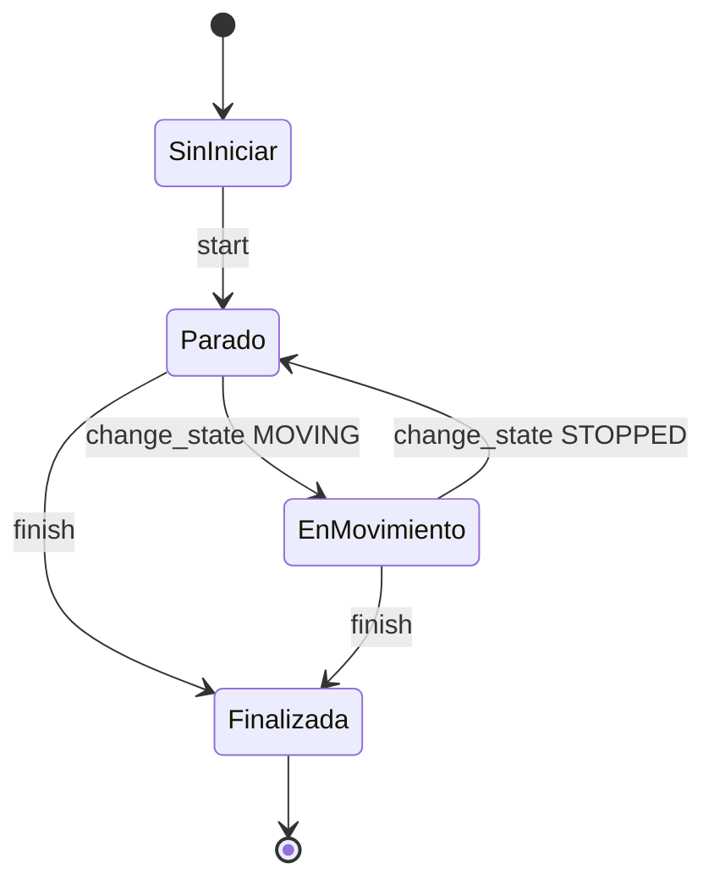
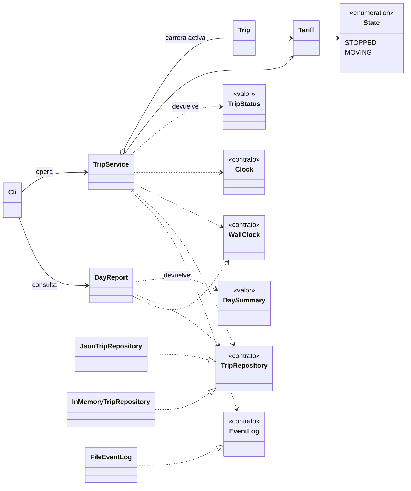
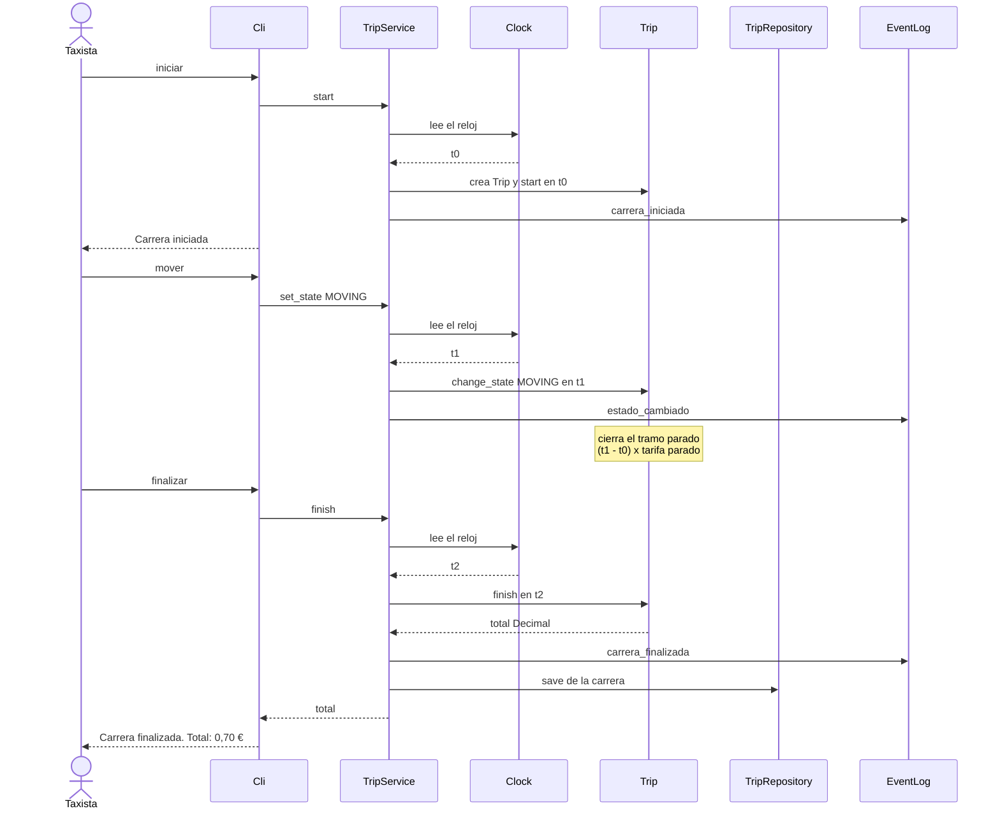

<!--
Proyecto: py-taximetro
fuente: docs/DESIGN.md
-->

# Diseño del taxímetro digital (TTX-247)

Cómo está pensado el código: de qué análisis salen las clases, cómo se reparten las responsabilidades y qué principios de programación orientada a objetos (POO) se aplican. Está escrito para explicárselo a compañeros: cada idea lleva un ejemplo real del proyecto.

## 1. Para qué sirve este documento

El proyecto tiene tres documentos de diseño, y cada uno responde a una pregunta distinta:

| Documento | Pregunta que responde |
|---|---|
| [ARCHITECTURE.md](ARCHITECTURE.md) | **Qué hay y cómo encaja**: módulos, capas, infraestructura, arranque, errores, pruebas |
| **DESIGN.md** (este) | **Cómo se pensó**: análisis, clases, responsabilidades y principios de POO |
| [DECISIONS.md](DECISIONS.md) | **Por qué se decidió así**: cada decisión de diseño, con su motivo |

Las decisiones se citan con su identificador y un enlace, por ejemplo [D26](DECISIONS.md#d26). El código siempre manda: si algo de aquí difiere de `src/taximetro/`, se corrige este documento.

**La idea principal.** El código ya era POO, con capas separadas y dependencias inyectadas, en la entrega de la Fase 2: 23 clases, cuatro contratos (puertos) y tres adaptadores. La tarea TK-05 («Refactor a POO con responsabilidades separadas») no creó la POO, sino que la **afinó**: repartió mejor las responsabilidades y añadió 5 clases más. El apartado [7](#7-evolución-del-diseño) cuenta qué cambió y por qué.

## 2. Del enunciado a las clases

### 2.1 Qué preguntas nos hicimos

Antes de escribir una clase, tres preguntas:

1. **¿Quién sabe qué?** Cada dato y cada regla deben vivir en un único sitio. Quién conoce la tarifa de cada estado, quién acumula el importe, quién sabe qué hora es.
2. **¿Qué cambia con qué frecuencia?** Las reglas del negocio cambian poco; la forma de guardar datos o de mostrarlos cambia mucho (consola hoy, ventana y API después). Lo que cambia a distinto ritmo va en clases distintas.
3. **¿Qué hay que poder sustituir para probar?** El reloj, el disco y el teclado deben poder cambiarse por dobles de prueba, para probar sin esperas ni ficheros.

### 2.2 De los requisitos a los conceptos

Una técnica sencilla: los **sustantivos** del enunciado son candidatos a clase, los **verbos** a métodos y las **reglas** a invariantes (condiciones que la clase protege siempre).

| Lo que dice el enunciado | Concepto | Clase |
|---|---|---|
| El taxi está parado o en movimiento | Estado del taxi | `State` (enumeración) |
| Se cobra por segundo según el estado | Tarifa | `Tariff` |
| Una carrera tiene un importe que va creciendo | Carrera | `Trip` |
| Iniciar, cambiar de estado, finalizar y encadenar carreras | Caso de uso | `TripService` |
| Ver el histórico del día | Consulta | `DayReport` y `DaySummary` |
| Las tarifas se leen de un fichero | Configuración | `load_tariff` y `Settings` |
| Guardar las carreras en disco | Repositorio | `TripRepository` (contrato), `JsonTripRepository`, `InMemoryTripRepository` |
| Registrar lo que ocurre para auditar | Registro de eventos | `EventLog` (contrato), `FileEventLog` |
| El taxista maneja el programa por consola | Interfaz | `Cli` |
| Algo puede ir mal (sin carrera, historial dañado…) | Errores del negocio | `TaximetroError` y sus subclases |

<a id="modelo-de-calculo"></a>
### 2.3 Modelo de cálculo y reglas de negocio

El importe de una carrera es la suma, por tramos, del tiempo transcurrido multiplicado por la tarifa del estado vigente:

```
importe = Σ  (duración del tramo en segundos × precio por segundo del estado)

parado:         0,02 €/s     (valores de config/rates.toml)
en movimiento:  0,05 €/s
```

Un tramo termina en cada cambio de estado o al finalizar. Ejemplo (10 s parado, 10 s en movimiento, 10 s parado):

```
10 × 0,02 + 10 × 0,05 + 10 × 0,02  =  0,20 + 0,50 + 0,20  =  0,90 €
```

**Reglas de negocio implementadas:**

1. Toda carrera comienza en estado parado.
2. El cambio de estado cierra el tramo anterior con la tarifa que tenía.
3. El total se redondea a céntimos con redondeo medio hacia arriba (`ROUND_HALF_UP`) **solo al final**.
4. Las tarifas son números finitos y no negativos.
5. El tiempo entre carreras no se cobra.
6. Solo hay una carrera activa a la vez.
7. El instante de una operación no puede ser anterior al de la última.
8. Las tarifas se leen del fichero de configuración al arrancar y no cambian durante la ejecución.
9. Cada carrera finalizada se guarda en el historial con su fecha de inicio y fin, los segundos en cada estado y el total.
10. **Un fallo del historial nunca esconde el importe**: si no se puede guardar, el total se muestra igualmente con un aviso y la carrera queda cerrada.
11. Un historial dañado o ilegible impide arrancar y **no se sobrescribe**.

<a id="ciclo-de-vida"></a>
### 2.4 Ciclo de vida de una carrera



Una carrera finalizada no admite más operaciones. Para iniciar otra, `TripService` crea una `Trip` nueva.

## 3. Diseño clase a clase

### 3.1 Mapa de clases



Las flechas de trazo continuo son «tiene» o «usa» y las discontinuas son «depende de un contrato». Ninguna clase del núcleo apunta a un adaptador concreto: solo a contratos.

| Clase | Capa | Tipo | Responsabilidad en una frase | Desde |
|---|---|---|---|---|
| `State` | `core` | Enumeración | Los dos estados posibles del taxi | Entrega presentada |
| `Tariff` | `core` | Objeto valor | Precio por segundo de cada estado, siempre válido | Entrega presentada |
| `Trip` | `core` | Entidad | Una carrera: acumula el importe por tramos | Entrega presentada |
| `TripService` | `core` | Caso de uso | Operar el taxímetro: iniciar, cambiar de estado, finalizar | Entrega presentada |
| `TripStatus` | `core` | Objeto valor | Estado e importe de la carrera en curso, ya calculados | TK-05 |
| `DayReport` | `core` | Caso de uso | Consultar las carreras terminadas de un día | TK-05 |
| `DaySummary` | `core` | Objeto valor | Las carreras de un día con su número y su total | TK-05 |
| `Clock`, `WallClock`, `TripRepository`, `EventLog` | `core` | Contratos (`Protocol`) | Lo que el núcleo necesita del exterior | Entrega presentada |
| `TaximetroError` y 10 subclases | `core` | Excepciones | Los errores del negocio, con una base común | Entrega presentada |
| `JsonTripRepository` | `infra` | Adaptador | Guarda las carreras en un fichero JSON | Entrega presentada |
| `InMemoryTripRepository` | `infra` | Adaptador | Guarda las carreras en una lista (pruebas) | Entrega presentada |
| `FileEventLog` | `infra` | Adaptador | Escribe un evento por línea en el fichero del día | Entrega presentada |
| `Cli` | `ui` | Interfaz | Traduce comandos de consola a llamadas y errores a mensajes | Entrega presentada |
| `Settings` | raíz | Objeto valor | De dónde salen las tarifas, los datos y los logs | TK-05 |
| `Application` | raíz | Objeto valor | Lo que necesita una interfaz: servicio, informe y notas | TK-05 |

Además hay dos funciones con responsabilidad propia: `load_tariff` (lee y valida el fichero de tarifas) y `build_application` (monta todo).

### 3.2 `State` y `Tariff`: lo más pequeño del dominio

`State` es una enumeración de dos valores. Vive en su propio módulo para romper una dependencia circular entre `Tariff` y `Trip` ([D6](DECISIONS.md#d6)).

`Tariff` es un **objeto valor**: no tiene identidad, solo datos, y es inmutable. Protege una condición, su **invariante**: ninguna tarifa puede ser negativa. Si se intenta crear una inválida, falla en ese momento, y por eso en el resto del programa nadie tiene que volver a comprobarlo:

```python
@dataclass(frozen=True)
class Tariff:
    stopped: Decimal
    moving: Decimal

    def __post_init__(self) -> None:
        if self.stopped < 0 or self.moving < 0:
            raise InvalidTariff("Las tarifas no pueden ser negativas.")

    def rate_for(self, state: State) -> Decimal:
        return self.moving if state is State.MOVING else self.stopped
```

El dinero es siempre `Decimal` y nunca `float`, para no arrastrar errores de redondeo binario ([D3](DECISIONS.md#d3)).

### 3.3 `Trip`: la entidad

`Trip` representa una carrera y es quien sabe calcular su importe. Tres decisiones de diseño la definen:

- **No conoce ningún reloj** ([D1](DECISIONS.md#d1)). Cada operación recibe el instante (`at`) como parámetro. Así el cálculo es determinista: la misma secuencia de instantes da siempre el mismo importe, y se prueba sin esperar un segundo real.
- **Su estado interno está encapsulado.** Los atributos empiezan por guion bajo (`_state`, `_accumulated`…) y se leen mediante propiedades de solo lectura. Nadie puede dejar la carrera en un estado incoherente desde fuera.
- **Distingue entre carrera en curso y carrera guardada.** `Trip.restore(...)` reconstruye una carrera ya terminada a partir de los datos del historial, sin tarifa, porque no hay que volver a calcular nada.

El corazón del cálculo cierra el tramo actual cada vez que cambia el estado:

```python
def change_state(self, state: State, at: float) -> None:
    self._accumulated = self._close_segment(at)
    self._add_seconds(at)
    self._state = state
    self._last_at = at

def _close_segment(self, at: float) -> Decimal:
    if self._finished:
        raise TripAlreadyFinished
    if self._state is None or self._last_at is None:
        raise TripNotStarted
    if at < self._last_at:
        raise InvalidTimestamp
    return self._accumulated + _seconds(self._last_at, at) * self.tariff.rate_for(self._state)
```

Las tres reglas de la entidad (no operar sobre una carrera terminada, no operarla sin iniciar y no retroceder en el tiempo) están en un único método privado, y todas las operaciones públicas pasan por él.

**API pública de `Trip`:**

| Elemento | Función |
|---|---|
| `start(at, when=None)` | Inicia la carrera en estado parado. `when` es la fecha y hora de pared de inicio. |
| `change_state(state, at)` | Cierra el tramo actual y cambia de estado. |
| `amount_at(at)` | Importe acumulado hasta `at`, sin cerrar la carrera. |
| `finish(at, when=None)` | Cierra el último tramo y devuelve el total en `Decimal` redondeado a 2 decimales. `when` es la fecha y hora de pared de fin. |
| `state` · `is_finished` | Consulta del estado actual y de si la carrera terminó. |
| `stopped_seconds` · `moving_seconds` | Segundos acumulados en cada estado. |
| `started_at` · `finished_at` | Fecha y hora de pared de inicio y fin, o `None` si no se indicaron. |
| `Trip.restore(...)` | Reconstruye una carrera terminada a partir de datos guardados (sin tarifa: ya no se recalcula). |

### 3.4 `TripService`: el caso de uso que opera

`TripService` es el **orquestador**: no calcula, **coordina**. Mantiene la carrera activa, lee los dos relojes, delega el cálculo en `Trip` y avisa al repositorio y al registro de eventos. Recibe todas sus dependencias por el constructor ([D26](DECISIONS.md#d26) explica por qué solo opera):

```python
class TripService:
    def __init__(
        self,
        tariff: Tariff,
        clock: Clock,
        wall_clock: WallClock,
        repository: TripRepository,
        event_log: EventLog,
    ) -> None:
        ...  # guarda las cinco dependencias y empieza sin carrera activa
```

Lo más delicado es `finish`, porque cobrar es lo primero:

```python
def finish(self) -> Decimal:
    trip = self._require_active()
    now = self._wall_clock()
    total = trip.finish(at=self._clock(), when=now)
    self._active = None  # libre para la siguiente carrera, aunque falle el guardado
    self._log(now, "carrera_finalizada", carrera=trip.id, total=str(total))
    try:
        self._repository.save(trip)
    except (OSError, TripHistoryError) as error:
        self._log(now, "carrera_no_guardada", carrera=trip.id, motivo=str(error))
        raise TripNotSaved(total, str(error)) from error
    return total
```

El orden importa: primero se calcula el total y se libera el servicio, y solo después se intenta guardar. Si el disco falla, el taxista sigue viendo el importe, porque `TripNotSaved` lleva el total dentro ([D17](DECISIONS.md#d17)). Por la misma razón, un fallo del registro de eventos se ignora durante la jornada ([D22](DECISIONS.md#d22)).

`status()` devuelve un `TripStatus` con el estado y el importe ya calculados, de modo que la interfaz no necesita navegar por la entidad `Trip`.

**API pública de `TripService`:**

| Elemento | Función |
|---|---|
| `start()` | Crea y arranca una carrera nueva con identificador único. |
| `set_state(state)` | Cambia el estado de la carrera activa. |
| `status()` | Estado e importe de la carrera en curso (`TripStatus`), o `None` si no hay ninguna. |
| `finish()` | Finaliza, guarda la carrera en el historial, devuelve el total y deja el servicio libre. Si el guardado falla, lanza `TripNotSaved` con el total. |
| `active` | La carrera activa, o `None`. |

### 3.5 `DayReport` y `DaySummary`: la consulta

Antes, `TripService` también contestaba preguntas del histórico. Ahora esa tarea es de `DayReport`, que **solo lee** del repositorio y no puede cambiar nada ([D26](DECISIONS.md#d26)). Devuelve un `DaySummary`, un objeto valor inmutable que ya trae el número de carreras y el total, de manera que quien lo muestra no tiene que calcular nada.

**API pública de `DayReport`:**

| Elemento | Función |
|---|---|
| `today()` | El día actual según el reloj de pared. |
| `for_day(day=None)` | Resumen (`DaySummary`) de las carreras terminadas ese día, de la más antigua a la más reciente; sin día, las de hoy. Delega en `TripRepository.list_finished`. |

`DaySummary` es inmutable y expone `day`, `trips`, `count` y `total`.

### 3.6 Contratos (puertos) y adaptadores

Un **contrato** dice qué necesita el núcleo sin decir cómo se hace. En Python se declara con `typing.Protocol`:

```python
class TripRepository(Protocol):
    def save(self, trip: Trip) -> None:
        """Guarda una carrera terminada."""
        ...

    def list_finished(self, day: date) -> list[Trip]:
        """Carreras terminadas en `day`, de la más antigua a la más reciente."""
        ...

    def check(self) -> None:
        """Comprueba que el historial se puede usar; si no, lanza `TripHistoryError`."""
        ...
```

Un **adaptador** es una clase concreta que cumple el contrato. No hace falta que herede de nada: basta con que tenga los mismos métodos. Por eso `time.monotonic` y `local_now`, que son simples funciones, cumplen los contratos `Clock` y `WallClock` sin envolverlas en clases.

| Contrato | Qué necesita el núcleo | Adaptadores reales | Dobles de prueba |
|---|---|---|---|
| `Clock` | Segundos monotónicos, para medir duraciones | `time.monotonic` | `FakeClock` |
| `WallClock` | Fecha y hora con zona, para saber *cuándo* | `local_now` | `FakeWallClock` |
| `TripRepository` | Guardar, listar por día y comprobar el historial | `JsonTripRepository`, `InMemoryTripRepository` | `BrokenRepository`, `UnreadableHistoryRepository` |
| `EventLog` | Anotar un evento con su hora | `FileEventLog` | `FakeEventLog`, `FailingEventLog` |

Solo existe un contrato cuando hay (o habrá) más de una implementación real ([D10](DECISIONS.md#d10)): no se crean abstracciones por si acaso. El registro de eventos tiene un contrato propio en lugar de usar el módulo `logging` de Python para que su marca de tiempo sea determinista en las pruebas ([D20](DECISIONS.md#d20)).

### 3.7 Los errores como jerarquía

Los errores del negocio forman una jerarquía con una base común, `TaximetroError`. Es el único uso de **herencia** del proyecto, y encaja porque es una relación «es un» real: todo error del taxímetro es un `TaximetroError`.

| Error | Cuándo se lanza |
|---|---|
| `TripNotStarted`, `TripAlreadyStarted`, `TripAlreadyFinished`, `InvalidTimestamp` | El uso incorrecto de una carrera |
| `InvalidTariff`, `TariffFileError` | Tarifas inválidas o fichero de tarifas ilegible |
| `InvalidTripRecord`, `TripHistoryError`, `TripNotSaved` | Problemas al guardar o leer el historial |
| `EventLogError` | La carpeta de logs no se puede usar |

La interfaz captura `TaximetroError` en un solo sitio y busca el mensaje del tipo concreto en una tabla (`ERRORS`). Así ninguna clase del negocio imprime ni conoce los textos que ve el usuario.

### 3.8 `Cli`: la interfaz

`Cli` traduce lo que se teclea en llamadas al servicio o al informe y lo que ocurre en mensajes legibles. Recibe el servicio, el informe, la función de entrada y la de salida, y las notas de arranque, de modo que se prueba entera con una consola simulada ([D4](DECISIONS.md#d4)).

En lugar de una cadena de `if/elif`, los comandos se guardan en una **tabla de despacho**, un diccionario de nombre a función:

```python
self._commands: dict[str, Callable[[], None]] = {
    "iniciar": self._start,
    "parar": lambda: self._set_state(State.STOPPED),
    "mover": lambda: self._set_state(State.MOVING),
    "estado": self._status,
    "finalizar": self._finish,
    "ayuda": lambda: self._print(HELP),
}
```

Añadir un comando es añadir una entrada, sin tocar el bucle principal.

### 3.9 `Settings`, `Application` y `bootstrap`: el montaje

Hay un único lugar que conoce todas las piezas y las conecta: la **raíz de composición**. Se reparte en tres módulos de la raíz del paquete:

- `Settings` decide de dónde salen las tarifas, los datos y los logs (valor explícito, variable de entorno o valor por defecto) ([D27](DECISIONS.md#d27)).
- `build_application` crea los adaptadores reales, monta el servicio y el informe, y **comprueba** el historial y los logs antes de arrancar ([D28](DECISIONS.md#d28)).
- `main` solo llama a lo anterior, traduce los errores de arranque en un mensaje y un código de salida, y lanza la consola.

```python
def build_application(settings: Settings, clock: Clock, wall_clock: WallClock) -> Application:
    repository = JsonTripRepository(settings.trips_file)
    event_log = FileEventLog(settings.log_dir)
    service = TripService(
        load_tariff(settings.rates_path), clock, wall_clock, repository, event_log
    )
    repository.check()
    event_log.check()
    notes = (f"Historial: {settings.trips_file}", f"Logs: {settings.log_dir}")
    return Application(service, DayReport(repository, wall_clock), notes)
```

`Application` es lo que necesita cualquier interfaz. Una ventana o una API futuras pedirían exactamente lo mismo, sin cambiar nada del núcleo.

## 4. Principios de POO aplicados

| Principio | Qué significa | Dónde se ve | Qué pasaría sin él |
|---|---|---|---|
| **Encapsulación** | Una clase protege su estado y solo deja tocarlo por su API | `Trip` oculta su estado con `_` y propiedades; `Tariff` rechaza valores inválidos al crearse | Cualquiera podría dejar una carrera a medias o crear una tarifa negativa |
| **Responsabilidad única** | Cada clase tiene una sola razón para cambiar | `TripService` opera, `DayReport` consulta, `Cli` presenta, `Settings` ubica, `bootstrap` monta | Una clase enorme que cambia por cualquier motivo |
| **Composición sobre herencia** | Se construye combinando objetos, no heredando | `TripService` *tiene* una carrera, una tarifa y cuatro colaboradores; la única herencia es la de los errores | Jerarquías rígidas y difíciles de probar |
| **Polimorfismo mediante contratos** | Varias clases intercambiables que cumplen el mismo contrato | `JsonTripRepository` e `InMemoryTripRepository` cumplen `TripRepository` | Cambiar de almacenamiento obligaría a modificar el servicio |
| **Inversión de dependencias** | El núcleo depende de contratos, no de detalles | `core` no importa de `infra` ni de `ui`, y un test lo comprueba ([D25](DECISIONS.md#d25)) | El negocio quedaría atado al disco, a la consola o a una librería |
| **Inyección de dependencias** | Las dependencias llegan por el constructor | Relojes, repositorio, registro, entrada y salida | Las pruebas necesitarían esperas reales, ficheros reales y teclado |
| **Objetos inmutables** | Un valor no cambia después de creado | `Tariff`, `TripStatus`, `DaySummary`, `Settings` y `Application` son `frozen` | Valores que alguien modifica sin querer mientras otro los usa |
| **Pedir el dato ya calculado** | No navegar por los objetos de otro para calcular algo | `TripService.status()` entrega un `TripStatus` en lugar de dejar que la interfaz lea `Trip` | La interfaz acabaría copiando reglas del negocio |

Lo que **no** hicimos, a propósito:

- **Clases abstractas para los repositorios.** Con `Protocol` basta que una clase tenga los métodos; los dobles de prueba no heredan de nada.
- **Un contrato para cada cosa.** Solo para lo que tiene más de una implementación real ([D10](DECISIONS.md#d10)).
- **Estado global o singletons.** Todo llega por el constructor.
- **`float` para el dinero** ([D3](DECISIONS.md#d3)) ni **base de datos antes de necesitarla** ([D15](DECISIONS.md#d15)): el repositorio SQL queda para la Fase 4.

## 5. Cómo colaboran los objetos

### 5.1 El montaje

Al arrancar, `main` construye los ajustes, `build_application` crea los adaptadores y los une a los casos de uso, y la interfaz recibe el resultado. Después, cada capa solo habla con la de dentro:

```
main ─► Settings ─► build_application ─► Application ─► Cli
                          │                                │
                          ├─ JsonTripRepository            ├─► TripService ─► Trip ─► Tariff
                          ├─ FileEventLog                  └─► DayReport
                          └─ TripService, DayReport
```

<a id="flujo-de-una-carrera"></a>
### 5.2 Una carrera completa, vista como mensajes entre objetos



## 6. Diseñado para probarse

El diseño no se hizo y después se probó: se hizo **para** probarse. Cada dependencia del exterior tiene un contrato y, por tanto, un doble de prueba. Con eso:

- el tiempo se simula (`FakeClock` avanza a mano), y las pruebas no esperan;
- los fallos del disco se provocan a voluntad (`BrokenRepository`, `UnreadableHistoryRepository`, `FailingEventLog`);
- la consola se simula con `ScriptedInput`, que además hace avanzar el reloj entre comandos;
- los repositorios reales y el de memoria pasan la **misma batería de pruebas de contrato**, que es lo que permite sustituir uno por otro con seguridad.

Un test de arquitectura (`tests/test_architecture.py`) lee los imports de cada fichero y falla si una capa importa de la que no debe. La guía de pruebas está en [TESTING.md](TESTING.md).

## 7. Evolución del diseño

### 7.1 Lo que ya era POO en la entrega presentada

En la Fase 2 el proyecto ya tenía `State`, `Tariff`, `Trip` y `TripService`; los cuatro contratos; los tres adaptadores (JSON, memoria y fichero de eventos); la jerarquía de errores y la interfaz `Cli`. Todo con dependencias inyectadas y capas separadas.

### 7.2 Lo que afinó TK-05

El nombre de la tarea en el backlog puede hacer pensar que antes no había POO. Lo que hizo fue **repartir mejor las responsabilidades**:

| Tema | Antes | Después | Decisión |
|---|---|---|---|
| Consultar el histórico | `TripService` también lo contestaba | `DayReport` consulta y `TripService` solo opera | [D26](DECISIONS.md#d26) |
| Importe de la carrera en curso | La interfaz leía la entidad `Trip` | `status()` devuelve un `TripStatus` ya calculado | [D26](DECISIONS.md#d26) |
| Rutas de tarifas, datos y logs | Funciones sueltas en `__main__` | `Settings` | [D27](DECISIONS.md#d27) |
| Montaje de las piezas | Todo dentro de `main` | `build_application` y `Application` | [D28](DECISIONS.md#d28) |
| Detectar un historial dañado | Se leía un día cualquiera como truco | `TripRepository.check()` | [D28](DECISIONS.md#d28) |
| Regla de dependencias entre capas | Una convención escrita | Un test que la comprueba | [D25](DECISIONS.md#d25) |

El resultado: de 23 a 28 clases, y las que ya existían quedaron con una responsabilidad más clara.

### 7.3 Lo que el diseño todavía deja pendiente

El diseño no es perfecto, y es útil saberlo:

- **`Trip` deja públicos tres atributos** (`id`, `tariff` y `total`), que se podrían modificar desde fuera. Se aceptó por simplicidad.
- **El contrato `TripRepository` importa la clase `Trip`**, lo que lo acopla al modelo. Es aceptable mientras `Trip` sea el único agregado.
- **La carrera activa vive solo en memoria** ([D5](DECISIONS.md#d5)): si el programa se cierra a mitad de carrera, no se recupera. La API de la Fase 4 obligará a revisarlo.

La lista completa de limitaciones está en [ARCHITECTURE.md](ARCHITECTURE.md#10-limitaciones-conocidas-y-deuda-técnica).

## 8. Cómo extenderlo

**Un almacenamiento nuevo** (por ejemplo, una base de datos relacional en la Fase 4):

1. Crear una clase en `infra/repos/` con `save`, `list_finished` y `check`.
2. Añadirla a la fixture de las pruebas de contrato, que comprobará que se comporta igual que las demás.
3. Elegirla en `build_application`. Nada más cambia: ni `TripService` ni `DayReport` la conocen.

**Una interfaz nueva** (ventana o API):

1. Crear un paquete en `ui/` que reciba una `Application`.
2. Usar `service` para operar y `report` para consultar; el núcleo no se toca.
3. Probarla con los dobles de prueba, igual que `Cli`.

**Una regla de negocio nueva:**

1. Escribir primero el test que la expresa, en rojo.
2. Implementarla donde vive el dato: en `Trip` si afecta al cálculo, en `Tariff` si afecta al precio.
3. Si necesita algo del exterior, definir antes el contrato.

## 9. Glosario

| Término | Significado |
|---|---|
| **Entidad** | Objeto con identidad cuyo estado cambia con el tiempo (`Trip`) |
| **Objeto valor** | Objeto sin identidad, inmutable, que solo contiene datos (`Tariff`, `TripStatus`) |
| **Invariante** | Condición que una clase garantiza siempre (una tarifa nunca es negativa) |
| **Caso de uso** | Clase que coordina una tarea del negocio (`TripService`, `DayReport`) |
| **Contrato o puerto** | Lo que el núcleo necesita del exterior, sin decir cómo se hace (`TripRepository`) |
| **Adaptador** | Clase concreta que cumple un contrato (`JsonTripRepository`) |
| **`Protocol`** | Forma de declarar un contrato en Python: basta con tener los mismos métodos |
| **Inyección de dependencias** | Pasar a una clase lo que necesita por el constructor, en lugar de que lo cree ella |
| **Raíz de composición** | El único sitio que conoce todas las piezas y las conecta (`bootstrap`) |
| **Doble de prueba** | Sustituto de una dependencia real para probar sin efectos (`FakeClock`) |
| **Cohesión y acoplamiento** | Cuánto encaja lo que hay dentro de una clase y cuánto depende de otras |

## 10. Recursos de Python que usa el código

Una guía para leer el código: qué recursos del lenguaje aparecen y dónde verlos.

| Recurso | Dónde se ve | Para qué |
|---|---|---|
| **Tipos de datos**: `Decimal`, `datetime` con zona horaria, `Enum` y `dataclass(frozen=True)` | [`core/tariff.py`](../src/taximetro/core/tariff.py), [`core/trip.py`](../src/taximetro/core/trip.py), [`core/trip_service.py`](../src/taximetro/core/trip_service.py) | Dinero exacto, fechas sin ambigüedad, estados cerrados y valores inmutables. `Trip.state` admite que aún no haya estado (tipo opcional) |
| **Colecciones tipadas**: diccionarios, listas y tuplas | La tabla de comandos `dict[str, Callable[[], None]]` y `dict[type[TaximetroError], str]` en [`ui/cli/app.py`](../src/taximetro/ui/cli/app.py); `list[Trip]` en el repositorio; `tuple[str, ...]` en `Application` | Elegir la acción por nombre sin una cadena de `if`, traducir errores a mensajes y devolver resultados que no se modifican |
| **Genéricos de la biblioteca estándar**: `Callable`, `Sequence`, `Mapping` y `Protocol` | [`core/ports.py`](../src/taximetro/core/ports.py) y las firmas de `Cli` | Describir qué se recibe sin atarlo a una clase concreta. No se definen genéricos propios con `TypeVar`, que no hacen falta en este proyecto |
| **Bucles** | El `while` con `break` y `continue` de `Cli.run`, y el `for` que imprime las notas de arranque | Mantener la consola esperando comandos hasta `salir` |
| **Condicionales** | Las cláusulas de guarda de `Trip._close_segment`: carrera terminada, sin iniciar o con el tiempo retrocedido | Proteger los invariantes de la entidad antes de calcular |
| **Excepciones** | `try/except` en `TripService.finish` y `_log`; `raise … from error` en los repositorios | Que un fallo del disco o del registro nunca esconda el importe ([D17](DECISIONS.md#d17), [D22](DECISIONS.md#d22)) |
| **Comprensiones y generadores** | `[trip for trip in … if …]` en `JsonTripRepository.list_finished` y `sum(… for …)` en `DaySummary.total` | Filtrar y sumar sin variables auxiliares |
| **Legibilidad** | Anotaciones de tipo en las funciones, docstrings, nombres descriptivos en `snake_case`, funciones cortas y cabecera de dos líneas en cada fichero | Que el código se lea solo. Lo comprueban Ruff y [`tests/test_conventions.py`](../tests/test_conventions.py) ([TESTING.md](TESTING.md#7-convenciones-de-los-tests)) |

La descomposición del problema en pasos (del enunciado a las clases) está en el apartado [2](#2-del-enunciado-a-las-clases) y el recorrido entrada, proceso y salida de una carrera, en el apartado [5](#5-cómo-colaboran-los-objetos).

## 11. Referencias

Documentación oficial, en inglés, en la que se apoya el diseño de las clases.

| Fuente | Qué se aplicó |
|---|---|
| [Python: `decimal`](https://docs.python.org/3/library/decimal.html) | Importes en `Decimal` y redondeo medio hacia arriba al final, sin errores de coma flotante ([D3](DECISIONS.md#d3)) |
| [Python: `dataclasses`](https://docs.python.org/3/library/dataclasses.html) | Objetos valor inmutables con `frozen=True`: `Tariff`, `TripStatus`, `DaySummary` y `Settings` |
| [Python: `typing.Protocol`](https://docs.python.org/3/library/typing.html#typing.Protocol) | Los contratos de `core/ports.py`, sin herencia ([D10](DECISIONS.md#d10)) |

Para seguir leyendo: [ARCHITECTURE.md](ARCHITECTURE.md) (qué hay y cómo encaja), [DECISIONS.md](DECISIONS.md) (por qué) y [TESTING.md](TESTING.md) (cómo se prueba).
