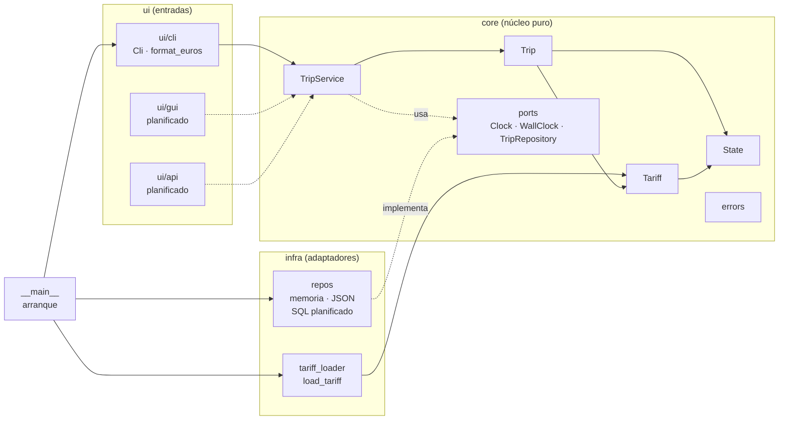
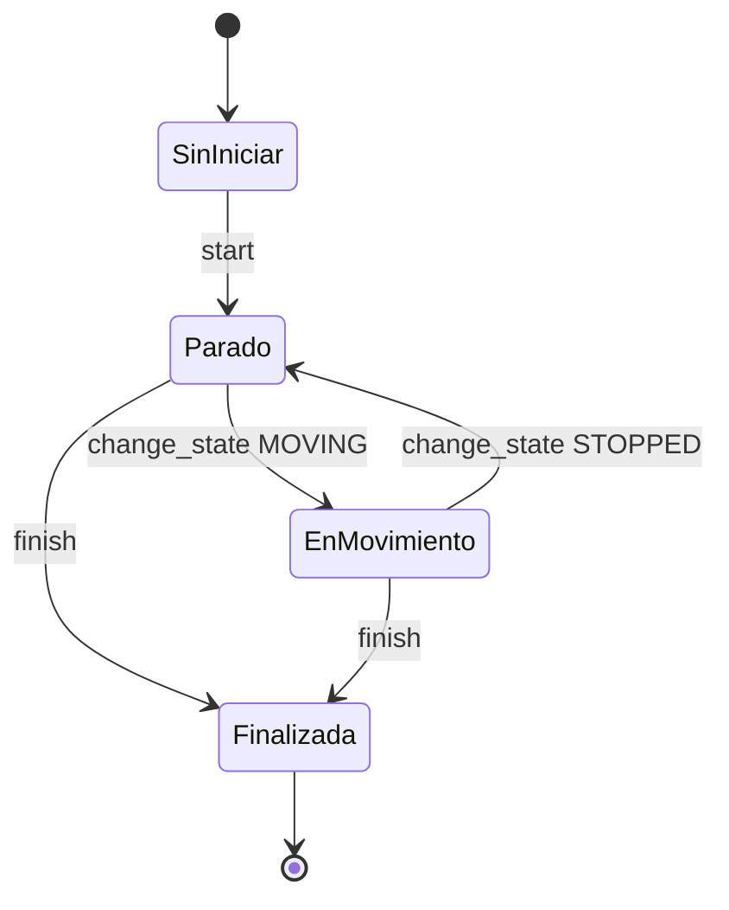
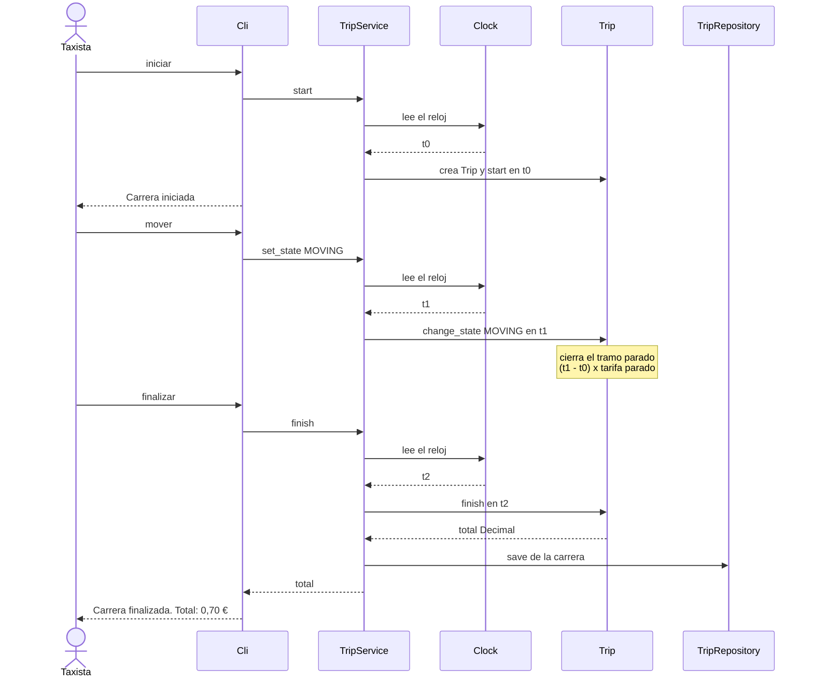
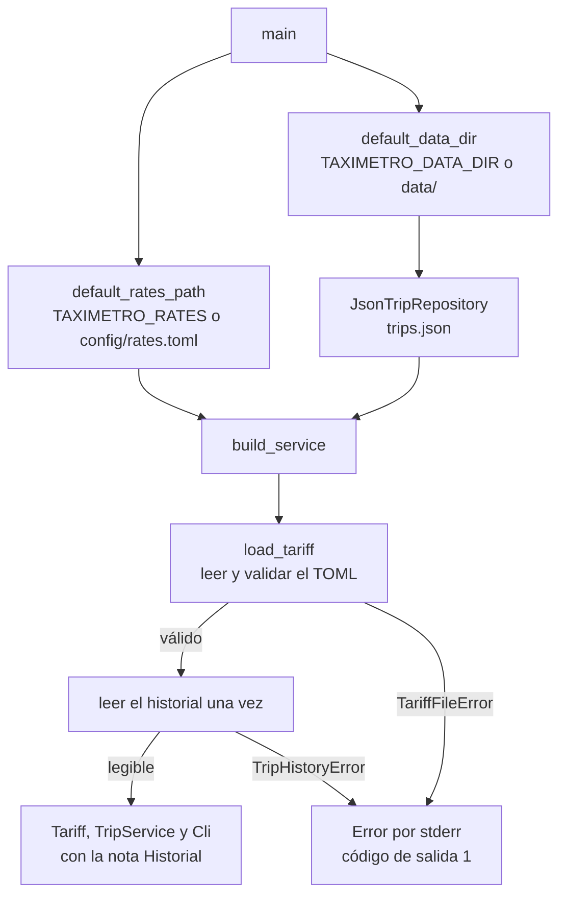

<!--
Proyecto: py-taximetro
fuente: docs/architecture.md
-->

# Arquitectura del taxímetro digital (TTX-247)

| | |
|---|---|
| **Proyecto** | py-taximetro (prototipo de TaxiTech Solutions S.L.) |
| **Alcance que refleja** | Fase 1 (MVP CLI): US-01 a US-04 y TK-02, más de la Fase 2: US-07 (tarifas en fichero de configuración) y TK-04 (historial de carreras en disco) |
| **Fuente de verdad** | El código en `src/taximetro/`. Si algo de este documento y el código difieren, manda el código. |

> **Convención de estado.** Cada elemento lleva una marca: ✅ implementado y probado, 🟡 existe pero aún no se usa, ⏳ planificado (no existe todavía).

---

## 1. Propósito y alcance

TaxiTech Solutions necesita sustituir sus taxímetros físicos por una solución 100 % software. Este repositorio es el **prototipo** que valida el concepto antes de contratar a un proveedor.

El taxímetro funciona por línea de comandos (Fase 1, más US-07 y TK-04 de la Fase 2) y:

- cobra por segundo según el estado del taxi (parado o en movimiento),
- muestra el importe acumulado y el total final en euros,
- permite encadenar carreras sin cerrar el programa,
- lee sus tarifas de un fichero de configuración, de modo que cambiar el cobro no exige tocar el código (US-07),
- guarda cada carrera finalizada en un historial en disco que se conserva al cerrar el programa, sin que un fallo del historial esconda nunca el importe (TK-04).

Este documento describe **cómo está construido** (módulos), **qué hace** (arquitectura funcional) y **por qué** se diseñó así (decisiones). Las fases 2 a 4 se recogen como evolución prevista en la sección 9.

---

## 2. Visión general

### 2.1 Estilo arquitectónico

**Núcleo puro con puertos y adaptadores (versión ligera).** El cálculo del negocio vive en un núcleo sin entrada/salida ni librerías externas. Todo lo que toca el mundo exterior (teclado, pantalla, reloj, disco) se queda en los bordes y se conecta al núcleo mediante contratos pequeños.

Tres paquetes, un punto de arranque:

| Paquete | Rol | Estado |
|---|---|---|
| `core/` | Reglas de negocio y casos de uso. No importa nada de `ui/` ni de `infra/`. | ✅ |
| `ui/` | Puertas de entrada del usuario: CLI hoy; GUI y API después. | ✅ CLI · ⏳ GUI, API |
| `infra/` | Adaptadores a recursos externos (carga de configuración, repositorios de datos, logging). | ✅ carga de tarifas y repositorios (memoria y JSON) · ⏳ repositorio SQL, logging |
| `__main__.py` | Punto de arranque: crea las piezas reales y las conecta. | ✅ |

**Regla de dependencias (solo hacia dentro):**

```
__main__  →  ui     →  core
          →  infra  →  core
```

El núcleo no conoce a nadie. Esa regla es la que permite probarlo sin teclado, sin pantalla y sin esperar tiempo real.

### 2.2 Diagrama de componentes



Los bloques marcados como `planificado` (GUI, API y el repositorio SQL) aún no existen en el código. Las líneas discontinuas indican «usa» o «implementa» un contrato.

---

## 3. Módulos codificados

### 3.1 Núcleo — `src/taximetro/core/`

| Módulo | Responsabilidad | Depende de | Estado |
|---|---|---|---|
| `state.py` | Enumeración `State` con los estados del taxi: `STOPPED` y `MOVING`. Vive en su propio módulo para evitar una importación circular entre `Tariff` y `Trip`. | — | ✅ |
| `errors.py` | Jerarquía de errores del dominio, con `TaximetroError` como base. Incluye `TariffFileError` (fallos al cargar las tarifas) y, para el historial: `InvalidTripRecord` (carrera que no se puede guardar: sin terminar o sin fechas), `TripHistoryError` (fichero dañado o ilegible) y `TripNotSaved` (la carrera se cobró pero no se guardó; lleva el total). | — | ✅ |
| `tariff.py` | `Tariff`: precio por segundo parado y en movimiento. Es inmutable (`frozen`), rechaza valores negativos y expone `rate_for(state)`. Los valores reales los aporta el cargador de tarifas (`infra/`). | `state`, `errors` | ✅ |
| `trip.py` | `Trip`: una carrera. Acumula el importe por tramos, cierra un tramo en cada cambio de estado y redondea el total a céntimos. **No conoce ningún reloj**: recibe el instante (`at`) en cada operación y, opcionalmente, la fecha y hora de pared (`when`). Acumula también los segundos parado y en movimiento, y expone `started_at` y `finished_at`. `Trip.restore(...)` reconstruye una carrera ya terminada a partir de los datos guardados. | `state`, `tariff`, `errors` | ✅ |
| `trip_service.py` | `TripService`: caso de uso. Mantiene la carrera activa, lee los dos relojes y delega el cálculo en `Trip`. Al finalizar guarda la carrera en el repositorio y libera la carrera activa para encadenar la siguiente, **incluso si el guardado falla** (en ese caso lanza `TripNotSaved` con el total). | `trip`, `tariff`, `ports`, `errors` | ✅ |
| `ports.py` | Contratos (`Protocol`): `Clock` (segundos monotónicos, para medir duraciones), `WallClock` (fecha y hora con zona horaria, para saber *cuándo*) y `TripRepository` (`save` y `list_finished`). | `trip` | ✅ |

**API pública de `Trip`:**

| Elemento | Función |
|---|---|
| `start(at, when=None)` | Inicia la carrera en estado parado. `when` es la fecha y hora de pared de inicio. |
| `change_state(state, at)` | Cierra el tramo actual y cambia de estado. |
| `amount_at(at)` | Importe acumulado hasta `at`, sin cerrar la carrera. |
| `finish(at, when=None)` | Cierra el último tramo y devuelve el total en `Decimal` redondeado a 2 decimales. `when` es la fecha y hora de pared de fin. |
| `state` · `is_finished` | Consulta del estado actual y de si la carrera terminó. |
| `stopped_seconds` · `moving_seconds` | Segundos acumulados en cada estado. |
| `started_at` · `finished_at` | Fecha y hora de pared de inicio y fin, o `None` si no se indicaron. |
| `Trip.restore(...)` | Reconstruye una carrera terminada a partir de datos guardados (sin tarifa: ya no se recalcula). |

**API pública de `TripService`:**

| Elemento | Función |
|---|---|
| `start()` | Crea y arranca una carrera nueva con identificador único. |
| `set_state(state)` | Cambia el estado de la carrera activa. |
| `current_amount()` | Importe actual de la carrera activa. |
| `finish()` | Finaliza, guarda la carrera en el historial, devuelve el total y deja el servicio libre. Si el guardado falla, lanza `TripNotSaved` con el total. |
| `active` | La carrera activa, o `None`. |

### 3.2 Interfaz de línea de comandos — `src/taximetro/ui/cli/`

| Módulo | Responsabilidad | Estado |
|---|---|---|
| `app.py` | `Cli`: bucle de lectura de comandos. Traduce cada comando a una llamada a `TripService` y los errores de dominio a mensajes legibles. Recibe `input_fn` y `output_fn`, por lo que se puede probar sin teclado ni pantalla. Contiene el texto de ayuda (`HELP`) y la tabla de mensajes de error (`ERRORS`). Al arrancar imprime las **notas** que recibe (por ejemplo, la ruta del historial) entre el título y la ayuda, sin saber de dónde vienen; y si el guardado falla al finalizar, muestra el total seguido de un `Aviso:`. | ✅ |
| `format.py` | `format_euros`: función pura que formatea un importe como `0,70 €` (coma decimal, dos decimales, redondeo medio hacia arriba). | ✅ |

**Comandos disponibles:**

| Comando | Acción |
|---|---|
| `iniciar` | Inicia una carrera (el taxi empieza parado). |
| `parar` | Pasa al estado parado. |
| `mover` | Pasa al estado en movimiento. |
| `estado` | Muestra el estado y el importe actual. |
| `finalizar` | Termina la carrera y muestra el total. |
| `ayuda` | Repite las instrucciones. |
| `salir` | Cierra el programa (avisa si hay una carrera sin cobrar). |

La entrada no distingue mayúsculas ni espacios sobrantes, e ignora las líneas vacías.

### 3.3 Infraestructura — `src/taximetro/infra/`

| Módulo | Responsabilidad | Estado |
|---|---|---|
| `tariff_loader.py` | `load_tariff(path)`: lee un fichero TOML y devuelve un `Tariff`. Convierte **todos** los fallos posibles en un único `TariffFileError`, con la clave o el fichero implicado, y conserva el error original como causa. | ✅ |
| `repos/memory.py` | `InMemoryTripRepository`: guarda las carreras en una lista; se pierden al cerrar el programa. Lo usan las pruebas. | ✅ |
| `repos/json_file.py` | `JsonTripRepository(path)`: guarda las carreras terminadas en un fichero JSON. Escritura atómica, errores claros y creación de carpetas (ver abajo). | ✅ |
| `repos/validation.py` | `ensure_can_be_saved`: reglas comunes a todo repositorio (la carrera debe estar terminada y tener fechas). | ✅ |
| `repos/` (SQL) | Repositorio relacional (Fase 4). | ⏳ |

El cargador se organiza en una función pública y cuatro privadas, cada una con una sola responsabilidad:

| Función | Responsabilidad |
|---|---|
| `load_tariff` | Orquesta: leer, localizar la tabla, extraer las claves y convertir |
| `_read_toml` | Abrir y decodificar el fichero (ausente, ilegible, codificación, sintaxis) |
| `_rates_table` | Localizar la tabla `[rates]` y comprobar que lo es |
| `_required_values` | Extraer las claves `stopped` y `moving` |
| `_to_decimal` | Validar y convertir un valor: texto, número, finito y no negativo |

El formato del fichero y los mensajes de error están en el [manual de uso](usage.md#7-configurar-las-tarifas).

#### Repositorio JSON

El fichero es una lista de registros, uno por carrera terminada:

```json
[
  {
    "id": "…",
    "started_at": "2026-11-11T10:00:00+01:00",
    "finished_at": "2026-11-11T10:05:00+01:00",
    "stopped_seconds": "30",
    "moving_seconds": "20",
    "total": "1.00"
  }
]
```

Las fechas se guardan en ISO 8601 con zona horaria y los importes y segundos **como texto**, para que `Decimal` no pase por `float` y no pierda precisión.

| Comportamiento | Cómo |
|---|---|
| **Escritura atómica** | `save` escribe en un fichero temporal en la misma carpeta y lo intercambia con `os.replace`. Un corte a mitad de escritura deja el historial anterior intacto; si algo falla, se borra el temporal |
| **Historial dañado** | Un fichero vacío, que no es JSON, que no es una lista o con un registro ilegible lanza `TripHistoryError` con la ruta y el motivo. `save` valida **antes** de escribir, así que un fichero dañado nunca se sobrescribe |
| **Historial ilegible** | Un fichero que existe pero no se puede leer (permisos, es una carpeta) también lanza `TripHistoryError` |
| **Primer arranque** | Si el fichero no existe, el historial está vacío. Listar nunca crea nada; guardar crea las carpetas que falten |
| **Qué carreras lista** | `list_finished(día)` devuelve las que **terminan** ese día, de la más antigua a la más reciente por hora de fin |

El repositorio en memoria y el JSON pasan la misma batería de tests de contrato (`tests/contract/`).
### 3.4 Arranque — `src/taximetro/__main__.py` ✅

Es el único módulo que conoce todas las piezas (*composition root*). Se ejecuta con `python -m taximetro` o con el comando `taximetro` (definido en `pyproject.toml`).

| Elemento | Función |
|---|---|
| `default_rates_path(environ)` | Decide de dónde se leen las tarifas: la variable `TAXIMETRO_RATES` (una variable vacía se ignora) o, si no existe, `config/rates.toml` en la raíz del proyecto. |
| `default_data_dir(environ)` | Decide la carpeta de datos: la variable `TAXIMETRO_DATA_DIR` (vacía se ignora) o, si no existe, `data/` en la raíz del proyecto. El historial es `trips.json` dentro de esa carpeta. |
| `build_service(rates_path, repository, clock, wall_clock)` | Carga las tarifas y crea el `TripService` con el repositorio que se le da. Es donde se unen la infraestructura y el núcleo. |
| `main(rates_path, data_dir, clock, input_fn, output_fn)` | Elige las rutas, crea el repositorio JSON, construye el servicio, **lee el historial una vez** para detectar un fichero dañado y lanza la CLI con la nota `Historial: <ruta>`. Devuelve el **código de salida**: `0` si todo va bien y `1` si el fichero de tarifas o el historial son inválidos, con el mensaje `Error: …` en `stderr`. Captura `TariffFileError` y `TripHistoryError`. |

Reloj, entrada y salida se inyectan, por lo que el arranque completo se prueba sin teclado ni esperas.

#### Ubicaciones de datos

| Qué | Variable | Por defecto | Estado |
|---|---|---|---|
| Tarifas (un fichero, solo lectura) | `TAXIMETRO_RATES` | `config/rates.toml` | ✅ |
| Historial (`trips.json`) | `TAXIMETRO_DATA_DIR` | `data/` | ✅ |
| Logs de ejecución | `TAXIMETRO_LOG_DIR` | `logs/` | ⏳ reservada para US-06 |

Los datos y los logs son **dos carpetas independientes** para poder montarlas en ubicaciones distintas en producción. Se configuran como carpetas y no como ficheros porque la escritura atómica necesita crear un temporal junto al fichero final, y montar un único fichero lo impediría (decisión D18).

### 3.5 Elementos que existen pero aún no se usan

| Elemento | Situación |
|---|---|
| `ui/gui/`, `ui/api/` | Paquetes vacíos que reservan el sitio de las fases 3 y 4. |
| `TAXIMETRO_LOG_DIR` | Carpeta de logs decidida pero sin código: llega con US-06. |
| `TripRepository.list_finished` | Implementado y probado en los dos repositorios, pero ningún comando de la CLI lo usa todavía: entra con US-05 (histórico del día). |

---

## 4. Arquitectura funcional

### 4.1 Modelo de cálculo

El importe de una carrera es la suma, por tramos, del tiempo transcurrido multiplicado por la tarifa del estado vigente:

```
importe = Σ  (duración del tramo en segundos × precio por segundo del estado)

parado:         0,02 €/s     (valores de config/rates.toml)
en movimiento:  0,05 €/s
```

Un tramo termina en cada cambio de estado o al finalizar. Ejemplo (10 s parado, 10 s en movimiento, 10 s parado):

```
10 × 0,02 + 10 × 0,05 + 10 × 0,02  =  0,20 + 0,50 + 0,20  =  0,90 €
```

**Reglas de negocio implementadas:**

1. Toda carrera comienza en estado parado.
2. El cambio de estado cierra el tramo anterior con la tarifa que tenía.
3. El total se redondea a céntimos con redondeo medio hacia arriba (`ROUND_HALF_UP`) **solo al final**.
4. Las tarifas son números finitos y no negativos.
5. El tiempo entre carreras no se cobra.
6. Solo hay una carrera activa a la vez.
7. El instante de una operación no puede ser anterior al de la última.
8. Las tarifas se leen del fichero de configuración al arrancar y no cambian durante la ejecución.
9. Cada carrera finalizada se guarda en el historial con su fecha de inicio y fin, los segundos en cada estado y el total.
10. **Un fallo del historial nunca esconde el importe**: si no se puede guardar, el total se muestra igualmente con un aviso y la carrera queda cerrada.
11. Un historial dañado o ilegible impide arrancar y **no se sobrescribe**.

### 4.2 Trazabilidad: historia de usuario → módulos → pruebas

| Historia | Qué cubre | Módulos que intervienen | Prueba de aceptación |
|---|---|---|---|
| **US-01** (#2) | Iniciar una carrera con un comando | `Cli._start`, `TripService.start`, `Trip.start` | `test_us01_iniciar_carrera_con_un_comando` |
| **US-02** (#3) | Cambiar entre parado y en movimiento | `Cli._set_state`, `TripService.set_state`, `Trip.change_state`, `Tariff.rate_for` | `test_us02_cambiar_entre_parado_y_en_movimiento` |
| **US-03** (#4) | Finalizar y ver el total en euros | `Cli._finish`, `TripService.finish`, `Trip.finish`, `format_euros` | `test_us03_finalizar_muestra_el_total_con_dos_decimales` |
| **US-04** (#5) | Encadenar carreras sin cerrar el programa | `TripService.finish` (libera la carrera activa), bucle de `Cli.run` | `test_us04_encadenar_carreras_sin_cerrar_el_programa` |
| **TK-02** (#12) | Instrucciones de uso al arrancar | `HELP` y `Cli.run` | `test_muestra_instrucciones_al_arrancar` |
| **US-07** (#8) | Tarifas en fichero de configuración | `load_tariff`, `default_rates_path`, `build_service`, `main` | `test_el_servicio_cobra_con_las_tarifas_del_fichero` y `test_con_un_fichero_valido_lanza_la_cli_con_esas_tarifas_y_devuelve_0` |
| **TK-04** (#14) | Historial guardado en disco | `JsonTripRepository`, `ensure_can_be_saved`, `TripService.finish`, `Trip.restore`, `default_data_dir`, `main` | `test_las_carreras_terminadas_se_conservan_al_reiniciar_el_programa` y el resto de `test_fase2_historial.py` |
| — | Consulta del importe en curso (`estado`) | `Cli._status`, `TripService.current_amount`, `Trip.amount_at` | `test_estado_con_carrera_muestra_estado_e_importe` |

### 4.3 Ciclo de vida de una carrera



Una carrera finalizada no admite más operaciones. Para iniciar otra, `TripService` crea una `Trip` nueva.

### 4.4 Flujo de una carrera completa



### 4.5 Arranque: tarifas e historial



Si el fichero de tarifas o el historial son inválidos el programa **no arranca**: no existe ninguna tarifa por defecto (decisión D11) y un historial dañado no se sobrescribe (decisión D17).

### 4.6 Manejo de errores

Los errores de negocio son excepciones del dominio. `Cli._dispatch` las captura y muestra un mensaje; el programa **no se cierra**.

| Excepción | Cuándo se lanza | Mensaje en la CLI |
|---|---|---|
| `TripNotStarted` | Cambiar estado, consultar o finalizar sin carrera activa | "No hay ninguna carrera en curso. Usa 'iniciar'." |
| `TripAlreadyStarted` | Iniciar con otra carrera ya en curso | "Ya hay una carrera en curso. Usa 'finalizar' antes de iniciar otra." |
| `TripAlreadyFinished` | Operar sobre una `Trip` ya finalizada | "La carrera ya está finalizada." |
| `InvalidTimestamp` | Instante anterior al último registrado | "El reloj retrocedió; no se puede continuar la carrera." |
| `InvalidTariff` | Construir una `Tariff` con valores negativos | No llega a la CLI: el cargador valida antes los valores del fichero |
| `TariffFileError` | El fichero de tarifas falta, no se puede leer, está mal formado o tiene valores inválidos | No llega a la CLI: al arrancar se imprime `Error: …` por `stderr` y el código de salida es 1 |
| `TripHistoryError` | El historial está dañado (no es JSON, no es una lista, un registro ilegible) o existe pero no se puede leer | **Al arrancar**: `Error: …` por `stderr` y código de salida 1. **Al finalizar una carrera**: `TripService` lo convierte en `TripNotSaved` |
| `TripNotSaved` | La carrera se cobró, pero no se pudo guardar (`OSError` o `TripHistoryError`) | La CLI muestra `Carrera finalizada. Total: …` y después `Aviso: No se pudo guardar la carrera en el historial: …` |
| `InvalidTripRecord` | Intentar guardar una carrera sin terminar o sin fechas: un error de programación | **No** se convierte en `TripNotSaved`, para no disfrazarlo de problema del disco |

Con `time.monotonic` el reloj no retrocede, y `TripService` descarta la carrera al finalizar, por lo que `InvalidTimestamp` y `TripAlreadyFinished` solo aparecen al usar `Trip` directamente o con un reloj de pruebas.

---

## 5. Decisiones de diseño

| # | Decisión | Motivo |
|---|---|---|
| D1 | **`Trip` no tiene reloj**: recibe `at` en cada operación y es el servicio quien lee el `Clock`. | El cálculo es determinista y se prueba sin esperas ni `sleep`. |
| D2 | **Reloj inyectado** como dependencia (`Clock`): `time.monotonic` en producción y `FakeClock` en pruebas. | Permite simular el paso del tiempo a voluntad. `monotonic` no se ve afectado por cambios en la hora del sistema. |
| D3 | **`Decimal` para el dinero**, nunca `float`. Los segundos se restan a partir de su representación textual. | Evita errores de redondeo binario. El redondeo solo se aplica al final. |
| D4 | **Entrada y salida inyectadas en `Cli`** (`input_fn`, `output_fn`). | La CLI se prueba entera con una consola simulada. |
| D5 | **La carrera activa vive en memoria** dentro de `TripService`; solo se guarda al terminar. | Una carrera en curso no tiene total ni fecha de fin. Guardar la carrera en curso se revisará con la API de la Fase 4. |
| D6 | **`State` en su propio módulo.** | Rompe la dependencia circular `Tariff` ↔ `Trip`. `Trip` lo reexporta para no romper importaciones. |
| D7 | **Las tarifas viven en `config/rates.toml`**, con los valores como **texto** (`"0.02"`). | Cambiar el cobro no exige tocar el código. Como texto, el valor es un `Decimal` exacto; un número sin comillas es un `float` binario con error de redondeo, y se rechaza. |
| D8 | **Un único punto de arranque** (`__main__`). | Una interfaz futura (GUI o API) solo necesita su propio arranque y reutiliza el mismo núcleo. |
| D9 | **Sin dependencias externas en ejecución** (`dependencies = []`). Solo la biblioteca estándar. | Mínima superficie; las extras `sql` y `api` se instalan cuando haga falta. |
| D10 | **Solo existen puertos con más de una implementación real** (`Clock`, `TripRepository`). | Evita abstracciones sin uso. Se añade un puerto cuando aparece una segunda implementación. |
| D11 | **Un fichero de tarifas inválido impide arrancar**; no hay tarifa por defecto. | Cobrar con una tarifa equivocada es peor que no cobrar. El error sale por `stderr` y el código de salida es 1. |
| D12 | **`main` devuelve el código de salida** y recibe ruta, reloj y consola inyectables. | El arranque completo se prueba sin teclado ni esperas; el bloque `if __name__ == "__main__"` lo traduce en `SystemExit`. |
| D13 | **El cargador convierte todo fallo en `TariffFileError`** y conserva el error original (`from error`). | Quien lo llama gestiona un solo tipo de error y no pierde la información técnica. Se comprobó con una batería de entradas anómalas. |
| D14 | **Dos relojes**: `Clock` (monotónico, mide duraciones y se usa para cobrar) y `WallClock` (fecha y hora con zona, dice *cuándo*). `Trip` no lee ninguno. | El cobro no se altera si cambia la hora del sistema, y el historial puede decir cuándo ocurrió cada carrera. |
| D15 | **Historial en JSON** con fechas ISO 8601 con zona e importes como texto. | Legible y editable a mano, sin dependencias externas, sin perder precisión de `Decimal`. |
| D16 | **Escritura atómica**: temporal junto al fichero y `os.replace`. | Un corte a mitad de escritura no destruye el historial anterior. |
| D17 | **Un historial dañado o ilegible impide arrancar y nunca se sobrescribe**; un fallo al guardar nunca esconde el total (`TripNotSaved`). | Perder datos es peor que no arrancar, y el taxista debe poder cobrar siempre. |
| D18 | **Datos y logs en carpetas independientes**, configuradas como **directorios** (`TAXIMETRO_DATA_DIR`, `TAXIMETRO_LOG_DIR`), no como ficheros. | Se pueden montar en ubicaciones distintas en producción, y la escritura atómica necesita crear un temporal junto al fichero final. |
| D19 | **Contrato común** para los repositorios y la validación de guardado en un único sitio (`ensure_can_be_saved`). | Una implementación nueva solo se añade a la fixture parametrizada; las reglas no se duplican. |

---

## 6. Estrategia de pruebas

El proyecto se desarrolla con **TDD**: primero el test en rojo, luego el código mínimo en verde y después el refactor. La guía práctica (cómo ejecutarlas, dobles de prueba, contratos y mutaciones) está en [TESTING.md](TESTING.md).

| Nivel | Carpeta | Qué prueba | Pruebas |
|---|---|---|---|
| Unitarias del núcleo | `tests/unit/core/` | `Tariff`, `Trip` y `TripService` aislados | 42 |
| Unitarias de la CLI | `tests/unit/ui/` | `Cli` y `format_euros` con consola simulada | 18 |
| Aceptación | `tests/acceptance/` | US-01 a US-04 (4) y el historial en disco, TK-04 (3), de principio a fin | 7 |
| Convenciones | `tests/test_conventions.py` | Cabecera de cada `.py` (crece con cada fichero nuevo) | 53 |
| Integración | `tests/integration/` | Cargador de tarifas (30), repositorio JSON (15) y arranque (17), con ficheros temporales | 62 |
| Contrato | `tests/contract/` | La misma batería de 9 tests para el repositorio en memoria y el JSON | 18 |
| | | **Total** | **200** |

**Dobles de prueba** (`tests/fakes.py`): `FakeClock` (reloj que avanza a mano), `FakeWallClock` (reloj de pared controlable), `BrokenRepository` (guardado que siempre falla) y `ScriptedInput` (consola que devuelve comandos y avanza el reloj entre ellos). Los fixtures compartidos están en `tests/conftest.py`.

**Cobertura:** 99 % al cerrar TK-04. Todos los módulos están al 100 % salvo `__main__.py`, cuya única línea sin cubrir es la llamada `raise SystemExit(main())` del bloque `if __name__ == "__main__"`.

**Pruebas de mutación manuales:** el cargador y el arranque se comprobaron rompiendo el código a propósito (quitar una validación, cambiar un mensaje, alterar el orden de los `except`…). Los tests detectaron todas las roturas deliberadas que se probaron al cerrar US-07. Al cerrar TK-04 se repitió sobre el repositorio JSON, el arranque, `TripService`, la CLI y la validación común: 26 mutantes, 26 detectados.

---

## 7. Convenciones del repositorio

| Aspecto | Convención |
|---|---|
| Cabecera de cada fichero `.py` | Dos líneas al principio: `# Proyecto: py-taximetro` y `# fuente: <ruta desde la raíz>` (por ejemplo, `src/taximetro/core/trip.py`). Los ficheros vacíos, como los `__init__.py`, no la llevan. La regla se comprueba en `tests/test_conventions.py`. |
| Versión | La versión vive solo en `pyproject.toml`. El criterio de versionado y el estado de las versiones publicadas se documentan únicamente en el [README](../README.md#versionado); no se repiten en ningún otro fichero. |
| Documentación | `README.md` (entrada del repositorio: instalación, arranque y enlaces), `docs/usage.md` (manual de uso), `docs/architecture.md` (este documento), `docs/TESTING.md` (cómo se prueba) y `docs/CONTRIBUTING.md` (flujo de trabajo). El README resume y enlaza; el detalle vive en `docs/`, y el README es el único documento de la raíz. |
| Commits | Conventional Commits (`feat`, `fix`, `test`, `refactor`, `docs`, `chore`) con referencia al issue (`Refs #n`) |
| Ramas y PR | Una rama de release por fase y una rama por funcionalidad; `main` solo avanza tras la demo. Reglas completas en [CONTRIBUTING.md](CONTRIBUTING.md). |
| Seguimiento | Tablero GitHub Projects «TTX-247 Taxímetro» (campos Fase, Tipo, MoSCoW, Estimate y Status) y backlog en `docs/project_backlog.xlsx` |
| Estilo | `ruff` (líneas de hasta 100 caracteres) |

---

## 8. Ejecución y verificación

Comandos en Git Bash, desde la raíz del proyecto y con el entorno virtual activado:

```bash
python -m taximetro
```

Con otro fichero de tarifas:

```bash
TAXIMETRO_RATES=otras_tarifas.toml python -m taximetro
```

Con otra carpeta de datos:

```bash
TAXIMETRO_DATA_DIR=mis_datos python -m taximetro
```

```bash
python -m pytest -v
```

```bash
python -m pytest --cov=src/taximetro --cov-report=term-missing
```

```bash
python -m ruff check src tests
```

---

## 9. Evolución prevista (planificado, salvo lo indicado)

| Fase | Módulos nuevos o cambios | Issues |
|---|---|---|
| **Fase 2** — Observabilidad y persistencia | `infra/repos/` (memoria y JSON) implementando `TripRepository`; logging estructurado; comando de histórico del día. **Ya hecho:** cargador de tarifas desde `config/rates.toml` (US-07) y repositorio JSON del historial con la carpeta de datos (TK-04). **Pendiente:** carpeta de logs `TAXIMETRO_LOG_DIR` (US-06) y la consulta del histórico (US-05) | US-05 (#6), US-06 (#7), US-07 (#8), TK-03 (#13), TK-04 (#14) |
| **Fase 3** — Arquitectura y UI | Refuerzo de la POO y de las responsabilidades; acceso con contraseña (hash, sin texto plano); `ui/gui/` en tkinter sin bloquear la ventana | US-08 (#9), US-09 (#10), TK-05 (#15) |
| **Fase 4** — Producción | Repositorio SQL; `ui/api/` (API REST: iniciar, cambiar, finalizar, consultar); panel web para el responsable de flota; despliegue con un único comando (Docker) | TK-06 (#16), TK-07 (#17), TK-08 (#18), TK-09 (#19) |
| **Transversal** | README con instrucciones y justificación de librerías; tablero y Conventional Commits | TK-10 (#20), TK-11 (#21) |

**Impacto previsto en la arquitectura:** la API (Fase 4) no tiene estado entre peticiones, así que la carrera activa deberá guardarse en el repositorio con `save` (D5 se revisará entonces). El diseño actual ya lo permite porque `TripRepository.save` está pensado para carreras en curso y terminadas.

---

## 10. Limitaciones conocidas y deuda técnica

| # | Limitación | Plan |
|---|---|---|
| L1 | **Regla de 20 km/h.** El enunciado cobra la tarifa baja por debajo de 20 km/h, pero el modelo solo distingue parado y en movimiento, sin velocidad. | Valorar un estado derivado de la velocidad si el enunciado lo exige. |
| L2 | **Las tarifas se leen una sola vez, al arrancar**: cambiar el fichero exige reiniciar el programa. | Aceptable; la recarga en caliente queda fuera del alcance. |
| L3 | **Solo se guardan las carreras finalizadas**: una carrera en curso al cerrar el programa no se cobra ni se recupera. | Revisar con la API de la Fase 4 (D5). |
| L4 | Una sola carrera activa a la vez: un taxi, un taxímetro. No hay soporte multi-taxi. | Fuera del alcance del prototipo. |
| L5 | **El historial JSON se reescribe entero en cada guardado** y no admite dos programas escribiendo a la vez en la misma carpeta (leer-modificar-escribir): podrían perderse carreras. | Suficiente para un taxi; el repositorio SQL de la Fase 4 lo resuelve. |
| L6 | El módulo `taximetro.core.ports` importa `Trip`, lo que acopla el contrato al modelo. Es aceptable mientras `Trip` sea el único agregado. | Revisar si el modelo crece. |
| L7 | **La validación se repite**: el cargador comprueba que los valores no sean negativos (para poder nombrar la clave y el fichero) y `Tariff` también lo comprueba. | Duplicación asumida: `Tariff` debe protegerse aunque se construya por otro camino, como la API de la Fase 4. |
| L8 | **Las rutas por defecto dependen de la instalación en modo desarrollo**: se calculan desde la ubicación del código (`parents[2]`), y en una instalación normal no apuntarían a `config/` ni a `data/`. | Usar `TAXIMETRO_RATES` y `TAXIMETRO_DATA_DIR`; en la Fase 4 (Docker) se fijarán explícitamente. |
| L9 | **Una carpeta de datos que no es una carpeta no se detecta al arrancar**: si `TAXIMETRO_DATA_DIR` apunta a un fichero, el programa arranca y falla al guardar cada carrera, con el total y el aviso del motivo. | Comprobarlo al arrancar (ciclo pendiente). |
| L10 | **`TAXIMETRO_LOG_DIR` está reservada pero sin efecto**: aún no hay logs. | US-06. |

